# reef-pi Guide 1: Setup and Demonstration

| | |
|---|---|
| Published guide | <https://learn.adafruit.com/reef-pi-installation-and-configuration> |
| Author | Ranjib Dey |
| Guide number | 1 (of 7) |
| Screenshots reflect | reef-pi 7.0 (`main`); regenerate with `make guide-screenshots GUIDE=1` |
| Last synced with Adafruit | _not yet_ |

This is the working copy of the Adafruit Learn guide. Readers use the Adafruit page; edits are made
here and copied back by hand (see [the guides index](../README.md)). Hardware photos, diagrams and the
Raspberry Pi OS screenshots (raspi-config, terminal) are linked from Adafruit's CDN and are not
regenerated; reef-pi screenshots are generated by `front-end/e2e/guides/guide-01.spec.js`.

## Changes for 7.0

Copy-back checklist. The Adafruit pages are *Introduction*, *Parts*, *Raspberry Pi Configuration*,
*Installation and UI Overview* and *Testing*. Images are matched by the text next to them, because the
page source does not list them in reading order.

**Introduction, Parts:** no screenshot changes. The last Introduction image is an old-UI dashboard
screenshot ("dashboard, configured with different modules"); replace it with
`installation-and-ui-overview-02-dashboard-first-start-{desktop,mobile}.png` or retake it from a
controller with modules configured.

**Raspberry Pi Configuration:** no reef-pi screenshots (raspi-config and terminal images stay).

**Installation and UI Overview**

- Login prompt ("You'll get this login prompt"): replace with
  `installation-and-ui-overview-01-sign-in-{desktop,mobile}.png`.
- Dashboard after the first sign-in: replace with
  `installation-and-ui-overview-02-dashboard-first-start-{desktop,mobile}.png`. In 7.0 the dashboard
  shows "Not configured" tiles for Temperature, pH and ATO and an equipment strip; the sentence about "the
  error message at the top ... missing data for charting" no longer applies: **remove it**.
- Configuration tab with the name changed to `adafruit-test`: replace with
  `installation-and-ui-overview-03-settings-rename-capabilities-{desktop,mobile}.png`. The same image
  serves the "Settings" paragraph of the UI Overview (it shows the Capabilities section).
- "head to the Admin section and hit reload" and the UI Overview "Admin" paragraph: replace with
  `installation-and-ui-overview-04-admin-{desktop,mobile}.png`. The page also has **Sign Out** and a
  database download/import and an "Upgrade reef-pi to version" row, which the old text does not mention.
- Dashboard after the rename: replace with the dashboard image above, or **remove** the image. In 7.0 the
  controller name is not shown on the dashboard (only in the footer).
- "Authentication" paragraph: replace with
  `installation-and-ui-overview-05-authentication-{desktop,mobile}.png`.
- "Connectors & Drivers" paragraph: replace with
  `installation-and-ui-overview-06-drivers-{desktop,mobile}.png`.
- Text "At the top of reef-pi web UI, there are tabs ..." -> in 7.0 the routes are in a **sidebar** (on
  a phone: the bottom bar and its **More** menu). "Configuration > Settings > Capabilities" still holds
  the module switches.
- Section "Dashboard" (customizable grid, rows and columns, chart sizes in pixels, **Customize** button):
  **rewrite**: the 7.0 dashboard has fixed Temperature, pH and ATO tiles that appear once a probe or
  controller exists, and an equipment strip with on/off switches. There is nothing to customize.

**Testing**

- Outlet on GPIO 24: replace with `testing-01-connectors-new-outlet-{desktop,mobile}.png`.
- Equipment created with the outlet: replace with `testing-02-equipment-new-{desktop,mobile}.png`.
- Equipment toggle: replace with `testing-03-equipment-on-{desktop,mobile}.png`.
- Jack with pin 0 and the rpi driver: replace with `testing-04-connectors-new-jack-{desktop,mobile}.png`.
- Creating the light on the jack: replace with `testing-05-lights-new-{desktop,mobile}.png`.
- The new light in the list (with the **Auto** button): replace with
  `testing-06-lights-list-{desktop,mobile}.png`.
- Light edit with the manual/fixed profile at 50%: replace with
  `testing-07-light-fixed-profile-{desktop,mobile}.png`. Any confirmation dialog image for the **Auto**
  button is **not** regenerated: check whether 7.0 still asks for confirmation.
- Email alert setup: replace with `testing-08-telemetry-email-{desktop,mobile}.png` (filled with
  placeholder addresses and not saved; no test message is sent).
- Text "Create an outlet ... under the connectors section in the configuration tab" -> "Configuration >
  Connectors > **Add connector**, type **Outlet**, name, GPIO pin 24".
- Text "Let's create a jack with pin 0 and type rpi. Make sure to choose rpi as the driver" -> type
  **Jack**, driver **Raspberry Pi**, pins `0`.
- Text "By default lights are created with a fixed profile ... Click on the Auto button to change the light
  in manual mode ... change the profile to manual" -> 7.0 lists profiles Fixed, Interval, Diurnal, Random,
  Sine, Lunar, Circadian, Cyclic, Lightning and Solar; for the LED test choose **Fixed** and set the value
  to 50. **Needs maintainer check** (the old "manual" profile is gone from the editor).
- Text "Alert configuration is specified in the configuration tab under the telemetry section" ->
  unchanged; tick **Email alerts** to show the form (Server, Port, From, To, optional Username/Password),
  then **Update**, reload and **Send test message**.

**Needs maintainer check: install steps that may be outdated (not changed here)**

- The download commands use reef-pi **4.3** (`reef-pi-4.3-pi0.deb`); use the current 7.x package for
  the reader's Pi model.
- Raspberry Pi OS: the text assumes Raspbian with `raspi-config` and the 1-Wire / I2C / SPI menus and
  `dtoverlay=pwm-2chan` in `/boot/config.txt`. Newer Raspberry Pi OS (Bookworm) moved that file to
  `/boot/firmware/config.txt`; support is tracked in reef-pi issue #2193.
- "Pi Zero, 2, 3 any Pi B+ will work" and the parts links are unchanged.
- The default sign-in is still `reef-pi` / `reef-pi`.
- Capabilities in the Settings image are the defaults of a new controller (Equipment, Timers, ATO,
  Temperatures, Macro, Health check and Dashboard); the dev server enables more, which was removed for
  the image only.

## Overview


reef-pi is a DIY reef aquarium controller based on Raspberry Pi. It eases maintaining reef aquariums by
automating day to day reef keeping chores. [Reef aquariums](https://adafru.it/CqJ) are saltwater
aquariums with live corals. Keeping corals alive in the captive environment requires precise lighting,
strong water movement, and more stable water chemistry (salinity, pH, calcium etc) than fish-only marine
aquariums.

The controller software runs on Raspberry Pi and uses ancillary electronics for all of its
functionality. It's a modular controller and can be configured to run only a small set of features. Due
to the open nature of the project, it's also easier to adopt reef-pi electronics to accommodate new or
custom hardware (pumps, lights etc). This is the first guide in the reef-pi series which provides an
overview of the controller software features, installation process and finally testing it with some
common electronics (LED dimming, etc.). Though the reef-pi project's main goal is to automate reef
aquariums, it can be useful in freshwater aquariums or even general purpose equipment control (e.g. a
web-enabled powerstrip or building a Christmas lighting setup, etc.)

Following is a list of features reef-pi provides (also called modules):

1. Equipment control. On-demand or periodically using timers.
2. Salinity control, by detecting water level and when it falls below a threshold (due to evaporation)
   pour fresh water into the tank.
3. Temperature control. Monitoring tank temperature and switching on/off heater and chillers to maintain
   it within a range. Alert if temperature goes outside the specified temperature range.
4. Light simulation. Simulate diurnal cycle, lunar cycle and other means of sunrise to sunset simulation
   using LED lights.
5. pH control, continuous monitoring of tank pH, control equipment and dosing based on thresholds and
   alert if it goes beyond a specified range.
6. Automated dosing. Periodically add chemical reagents (e.g. calcium & alkalinity supplements) or liquid
   food in the tank.
7. Macro. Automate multi-step reef keeping workflows such as water change.


All in one (multiple modules) controller based on reef-pi.


reef-pi dashboard, configured with different modules.

## Parts

You will only need a working Raspberry Pi to play with the software. I highly recommend the kit version
as it comes with SD card, power supply and HDMI connector. Pi Zero, 2, 3 any Pi B+ will work.

- [Raspberry Pi Zero W Budget Pack](https://www.adafruit.com/product/3410): includes Pi Zero W
- 1 x [LED](https://www.adafruit.com/product/300)
- 1 x [Resistor](https://www.adafruit.com/product/2781): 470 ohm resistor
- 1 x [jumper wires](https://www.adafruit.com/product/1953): male female jumper wires
- 1 x [Breadboard, 1/2 size](https://www.adafruit.com/product/64)

## Raspberry Pi Configuration

reef-pi requires a Raspberry Pi running Raspbian or Noobs. Adafruit already has guides on
[Preparing SD card](https://adafru.it/dDL), [First-time configuration](https://adafru.it/dDM),
[Network](https://adafru.it/dDN) and [SSH](https://adafru.it/jvB) setup. We'll not repeat those, if you
are not familiar with Raspberry Pi, use those guides in exact order to get a working Raspberry Pi with
latest Raspbian installed and network configured.

It's always recommended you update Raspbian before installing reef-pi. We'll also enable network time to
keep the Raspberry Pi time up to date from the Internet.

```
sudo apt-get update -y
sudo apt-get upgrade -y
sudo systemctl start systemd-timesyncd
sudo systemctl enable systemd-timesyncd
```

reef-pi uses the [Raspberry Pi's hardware timers](https://adafru.it/CqK) for PWM (used for LED dimming,
DC motor control etc.). This allows reef-pi to use up to two PWM channels without any ancillary
electronics. This feature is only available in newer Linux kernels (4.9 and above). We have to edit the
`/boot/config.txt` file and add this line at the end to enable it (then reboot):

```
dtoverlay=pwm-2chan
```

reef-pi uses a DS18B20 temperature sensor, which requires the one wire protocol to be enabled in the
Linux kernel. reef-pi also uses the I2C communications protocol for some features. We'll use the
`raspi-config` tool from the terminal for enabling both one wire and I2C.

```
sudo raspi-config
```

From the terminal type `sudo raspi-config`, select **Interfacing Options**, then select **1-Wire**,
select **Yes** to enable, then restart.


### Update Hostname

You can use the `raspi-config` tool to rename the Raspberry Pi to something else. For example, I named
one of my reef-pi controllers as biocube29 (the name of the tank). Doing so allows accessing the reef-pi
web UI as `http://biocube29.local` from other devices in the same network.

### Disable SPI

reef-pi does not use SPI, and disabling it will allow reusing the SPI pins as normal GPIO. The
`raspi-config` utility can be used for this as well (disabling SPI).

### Reboot and Install reef-pi!

Finally, we're ready to install the software. `sudo reboot` the Pi to make all the changes active.

Next, download the [latest](https://adafru.it/Hdw) release of reef-pi and install it.

```
wget -c https://github.com/reef-pi/reef-pi/releases/download/4.3/reef-pi-4.3-pi0.deb
sudo dpkg -i reef-pi-4.3-pi0.deb
```

That's it! reef-pi should be installed and running, you should be able to access the reef-pi UI by
visiting the Raspberry Pi IP (or `hostname.local`, if you have set a hostname) in your browser. You'll
get this login prompt:

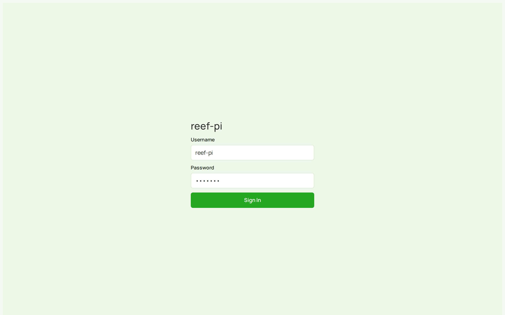
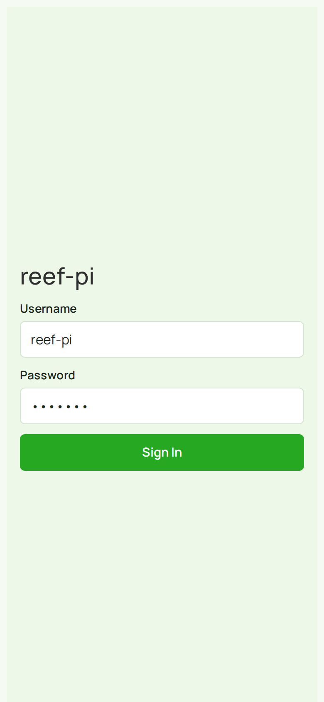

Enter `reef-pi` as both username and password and click **Sign In**. These are the default credentials
reef-pi ships with. You will then be redirected to the main dashboard:

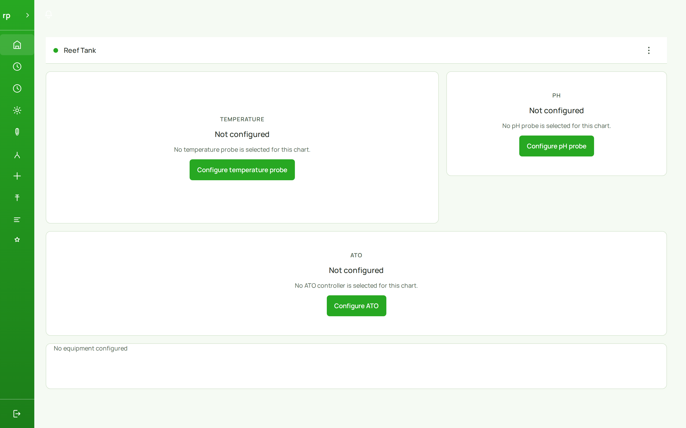
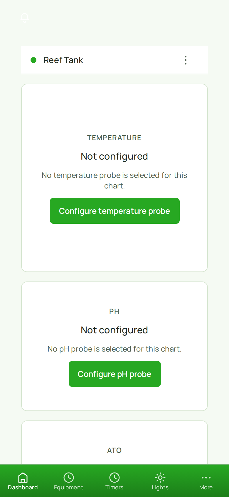

The tiles read "Not configured" until a temperature probe, pH probe or ATO exists: that is expected on a
fresh install. The footer shows the controller name, current time, reef-pi version, uptime, IP and any
error.

Next, let's customize the reef-pi installation for our specific use. For this, head over to
**Configuration** and change the controller name from `reef-pi` to `adafruit-test` and click the
**Update** button to save the setting.

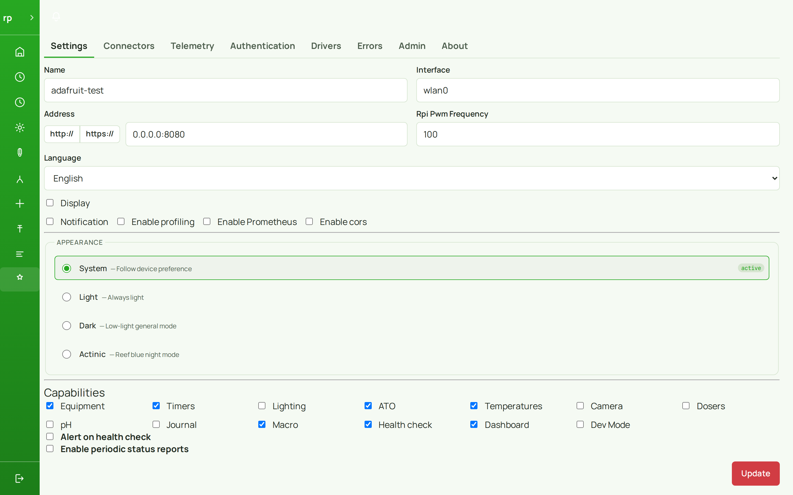
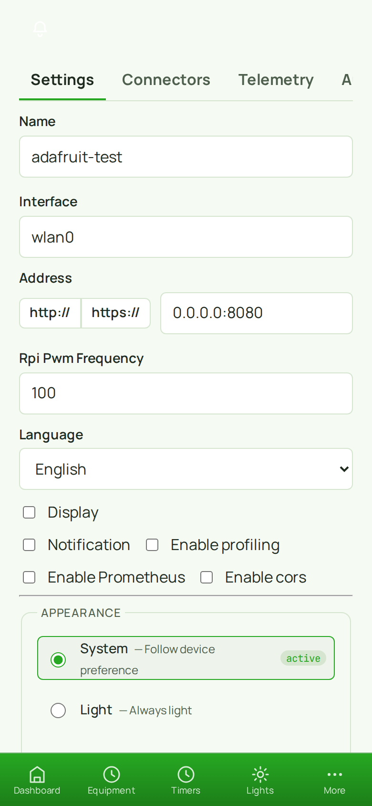

Once the name is updated, head to the **Admin** section and hit **Reload**. This will restart the reef-pi
program. Refresh your browser and you should see the name change in the UI.

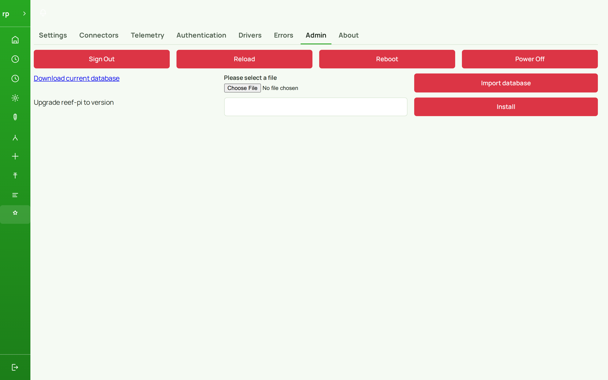
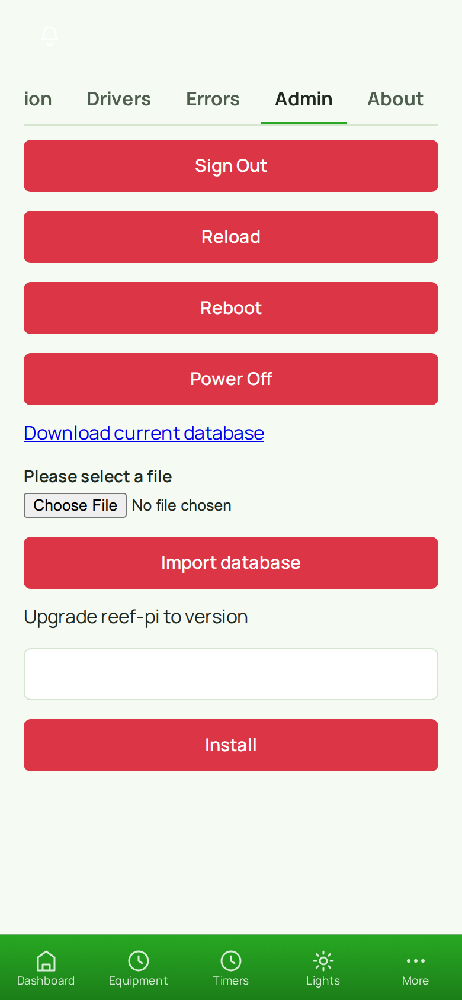

At this point, reef-pi is up and running and responding, nice work!

We will next take a brief look at the UI and modules in general and test some of them using simple LEDs.

## UI Overview

The reef-pi web UI has a sidebar (the bottom bar on a phone) with one entry per category of
functionality (also called modules). For example, the temperature controller features are under the
"temperature" entry. There are few entries that are not specific to a module and relevant to the
controller as a whole (like "configuration" and "dashboard"). Most of the time, the first page or landing
page is the dashboard. This is the default configuration that reef-pi ships with. It is possible to
disable the dashboard from the configuration module.

### Configuration

The Configuration UI holds all the meta information about the reef-pi controller. reef-pi configuration
shows what modules are active as well as features available in them. This is a brief overview of
individual sections as relevant in this guide. It is recommended that every new reef-pi build goes
through these steps to ensure appropriate setup and avoid hard to diagnose issues later in the build
process.

#### Admin

This section of the configuration holds administrative buttons that allow reload, reboot, power down and
sign off. Most of the changes in the configuration UI (like telemetry, authentication, settings etc.)
require a reload. A reload only restarts the controller software without restarting the whole Raspberry
Pi. The Reboot button restarts the whole Raspberry Pi including Raspbian and reef-pi software. The Power
Off button shuts down the Raspberry Pi, making it safe to unplug the power supply. It is recommended to
power off the reef-pi controller before unplugging the power cable or adding a new sensor, etc.

#### Settings

This is the section where the individual modules are activated or deactivated (under capabilities).
Controller name, network interface (ethernet or wifi) that is used to detect the IP address, and various
other global configuration (such as https) are enabled here. Any changes in settings require a reload to
come into effect.

#### Authentication

By default, reef-pi ships with the username and password set to `reef-pi`. You should update it to your
preferred username and password. I highly recommend using a password manager and setting a 32 character
random password (generated by a password manager). Note: As a security posture, reef-pi does not show any
password that's previously set in the UI. So, if you notice the password field is blank, it's normal and
expected. Once updated, username and password changes will require a reload of reef-pi to come into
effect.

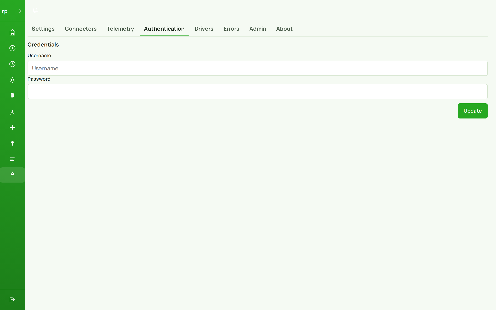
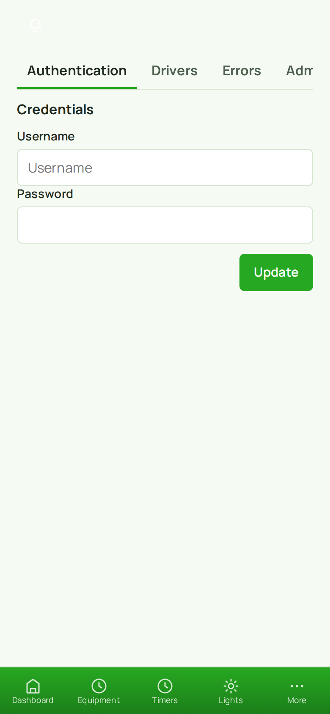

### Connectors & Drivers

All physical equipment and sensors are associated with the reef-pi controller using connectors. There are
four different types of connectors in reef-pi.

- **Outlets**: digital output connectors used for equipment control.
- **Inlets**: digital input connectors used for sensing water level and other on/off signals.
- **Jacks**: PWM output connectors used for light and wave maker controls.
- **AnalogInputs**: analog input connectors used for pH probes and current monitors.

Connectors are provided by Drivers. Individual drivers can offer multiple types and numbers of
connectors. For example, every reef-pi has a built-in Raspberry Pi driver that provides a number of pins
that can be used as either inlet or outlet, and two PWM pins (jack). reef-pi supports the pH board,
PCA9685 PWM and several other drivers, each of which exposes a variety of inlets, outlets, jacks and
analog inputs that we'll explore in this tutorial series.

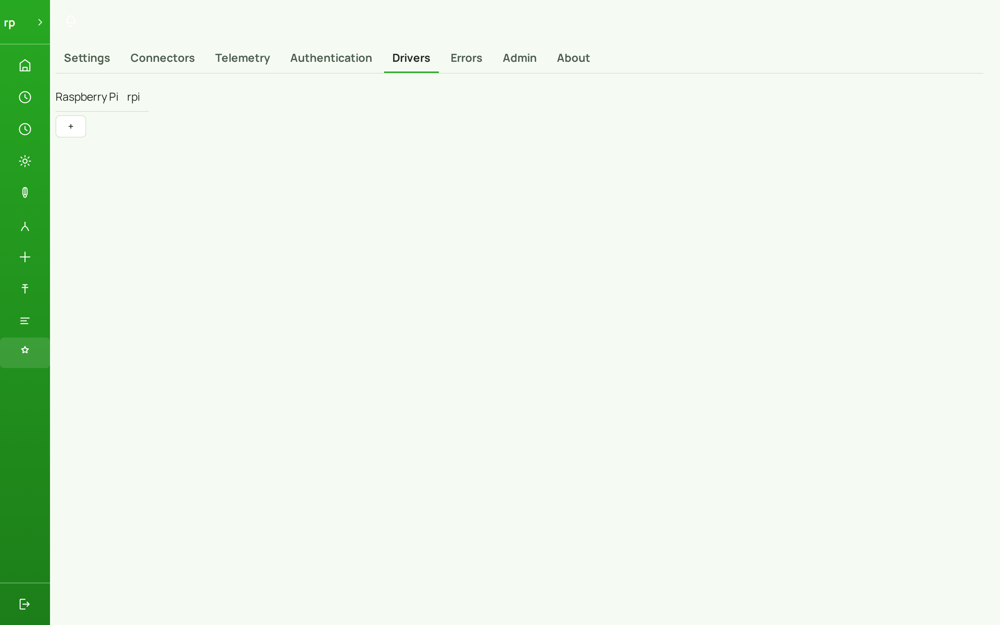
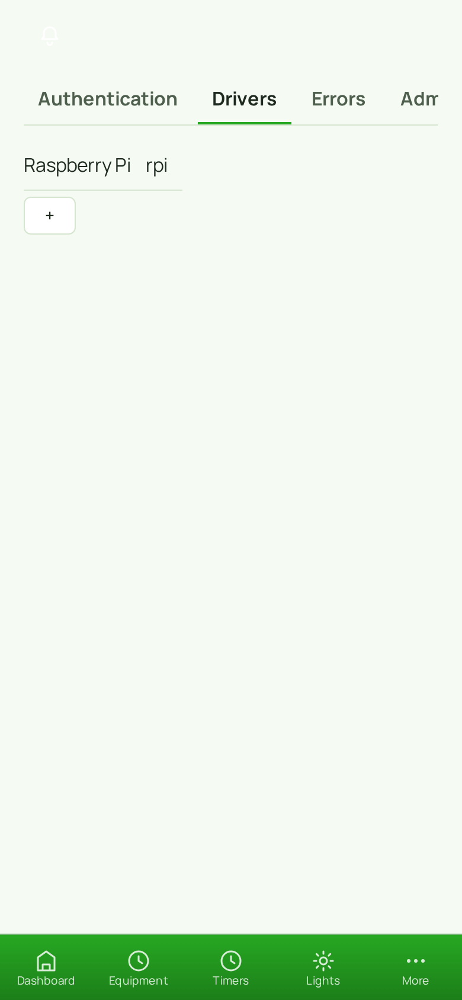

### Dashboard

The dashboard is a special capability of reef-pi that can be enabled and disabled from the settings
section under the configuration tab. When enabled, the dashboard shows a tile per monitored resource.

The exact tiles depend on what features are enabled and in use, since charts are generated from usage
data. For example, if the temperature module is enabled and a temperature controller is configured, then
a temperature tile with the latest reading, a gauge and a chart is shown. The equipment strip lists every
equipment item with an on/off switch.

Now that we have covered the basic UI components, let's use an LED to test a few modules of reef-pi on the
next page.

## Testing

### Equipment and Timers

Let's test reef-pi's equipment module with some prototype electronics. For this, we'll make an LED blink
on-demand and then using timers with reef-pi. Power off reef-pi and prepare the following circuit.


Connect Raspberry Pi GPIO pin 24 to the positive end of a common LED using a jumper wire. The negative
end of the LED should be connected to any of the Raspberry Pi's GND pins via a 470-ohm resistor.

Once the prototype circuit is in place, power up reef-pi and head over to **Configuration >
Connectors**. Create an outlet with GPIO pin 24.

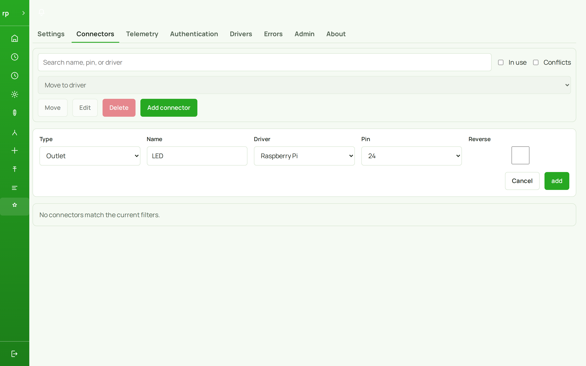
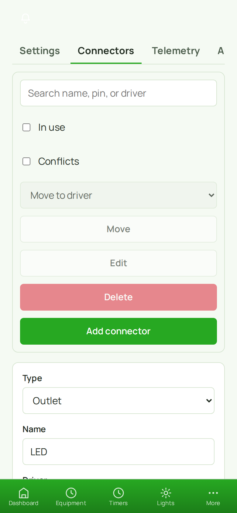

Next, head over to the **Equipment** page and create an equipment with the outlet:

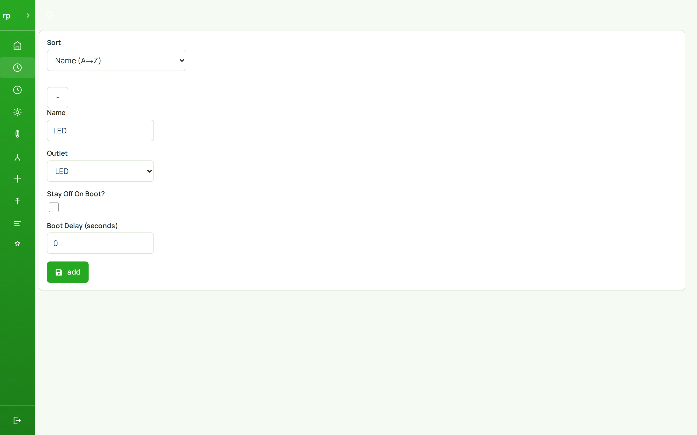
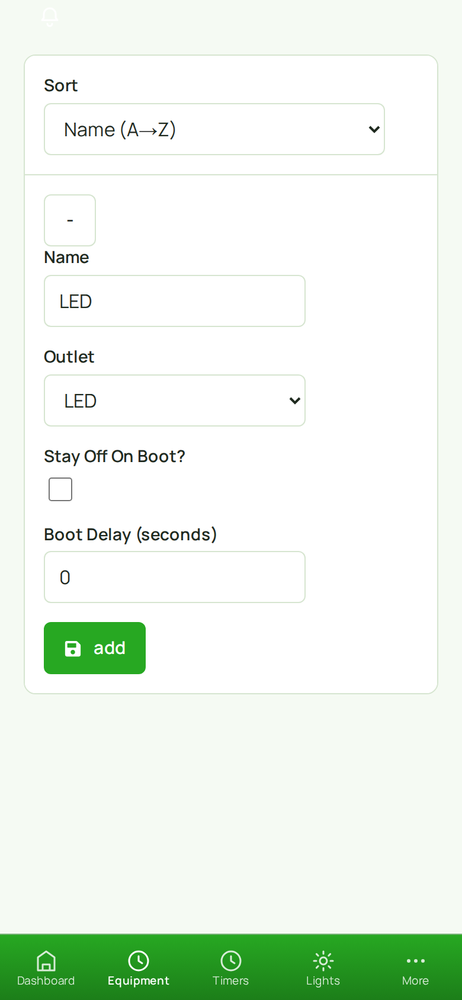

Once the test equipment is created, you can click on the on/off toggle switch and the LED should turn
on/off accordingly.

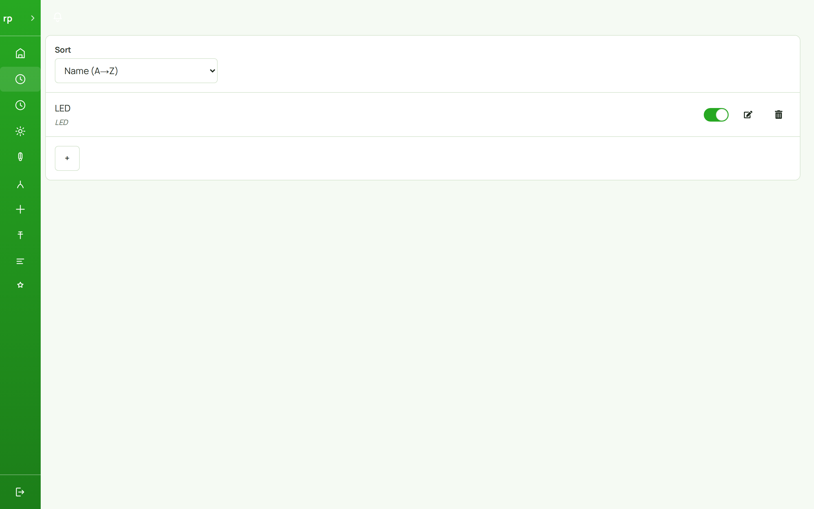
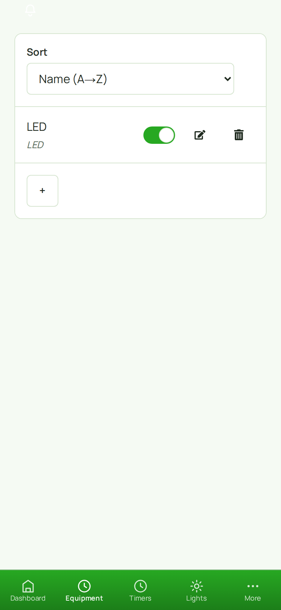


### Jacks and Lighting

In reef-pi, jacks refer to PWM output pins. They are used in dimming lights or controlling dosing pumps
etc. reef-pi supports native Raspberry Pi hardware timer-based PWM or PCA9685 board based PWM. In this
guide, we'll use Raspberry Pi based PWM.

A Raspberry Pi provides two hardware-based timers and, by default, they are on GPIO pins 18 and 19. The
Linux kernel uses these two pins to provide two PWM channels, which it calls 0 and 1. Thus in reef-pi,
jack numbers 0 and 1 represent Raspberry Pi GPIO 18 or 19 based PWM output pins.

Let's create a jack with pin 0 and the **Raspberry Pi** driver (make sure to choose it from the driver
dropdown).

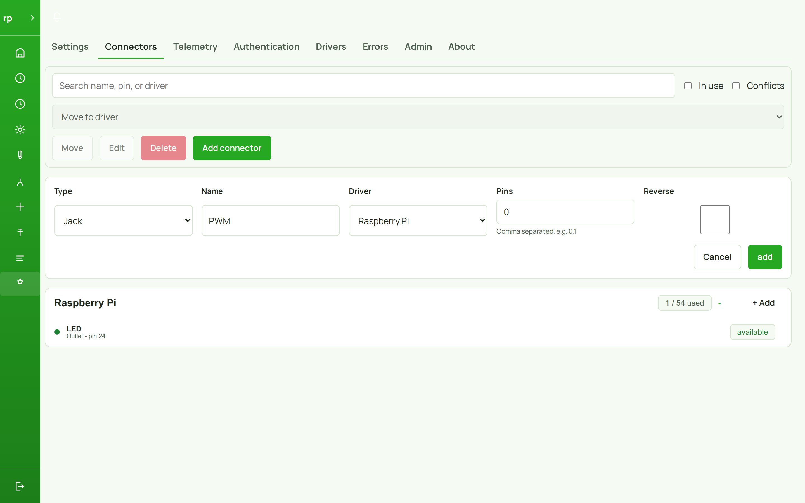
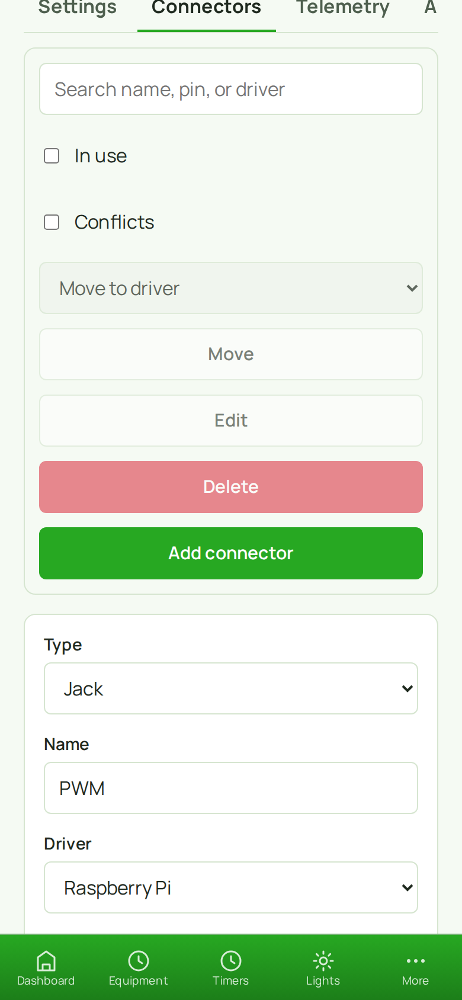

Next, head to the **Lights** page, create a light and associate the jack with it.

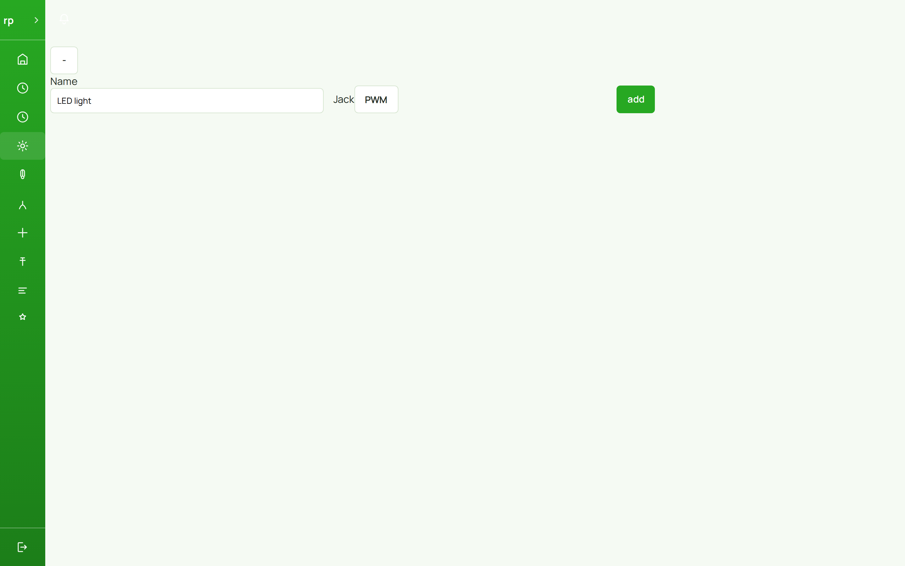
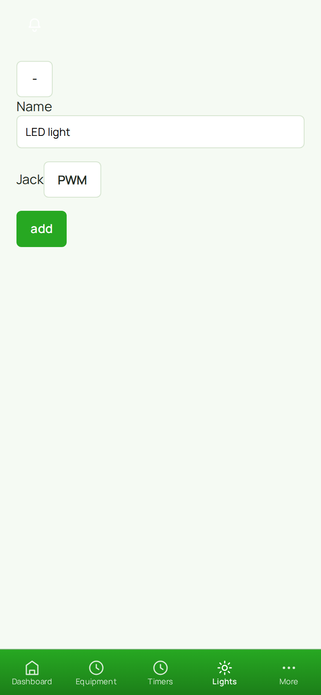

By default lights are created with a fixed profile, that automatically sets the light intensity to a fixed
value of 0. The light's row has an **Auto** button, which switches the light between its automatic profile
and on-demand control.

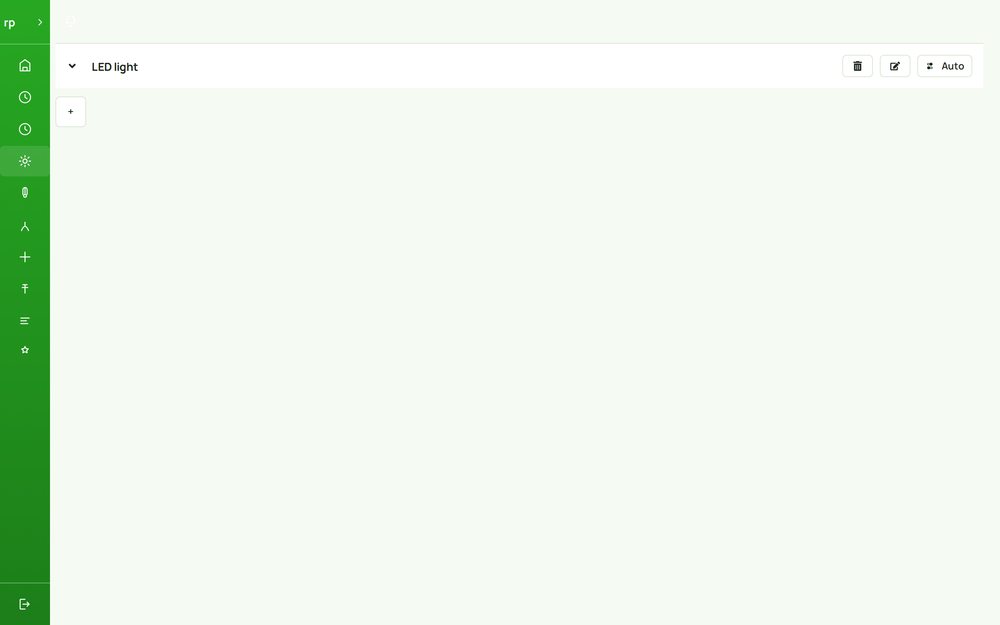
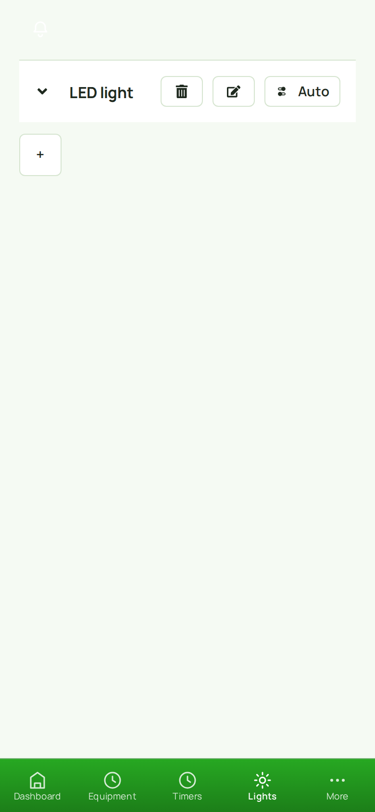

Edit the light, choose the **Fixed** profile, set the slider to 50% and click **Save**.

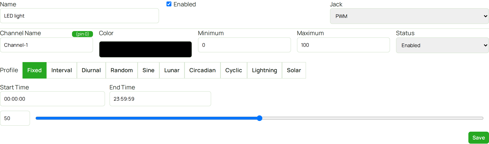
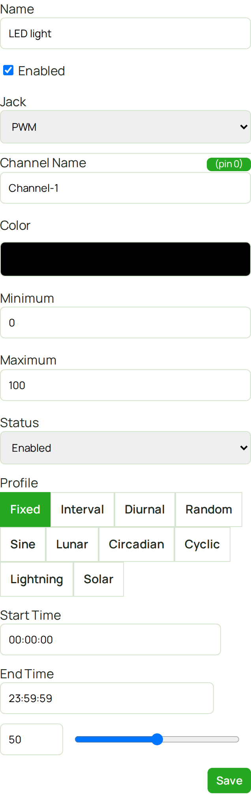

You should notice the LED wired to GPIO 18 turn on. You can verify the LED is being dimmed as you update
the light's value in reef-pi using the slider and click save. We'll use the same circuit with appropriate
transistors to make a full blown light controller in a later guide.

Equipment and light prototype circuit on a breadboard:


### Alert setup and test email

Next, we'll configure reef-pi to send email alerts when something bad happens (for example, a temperature
sensor returning higher than expected readings). Alert configuration is specified in **Configuration >
Telemetry**. It's highly recommended you use an app specific password instead of your main email
password. A user's email should always be protected by two factor authentication. For Gmail users, app
passwords can be generated [here](https://adafru.it/CqM). Similar things exist for Hotmail, Yahoo, and
most other online email providers.

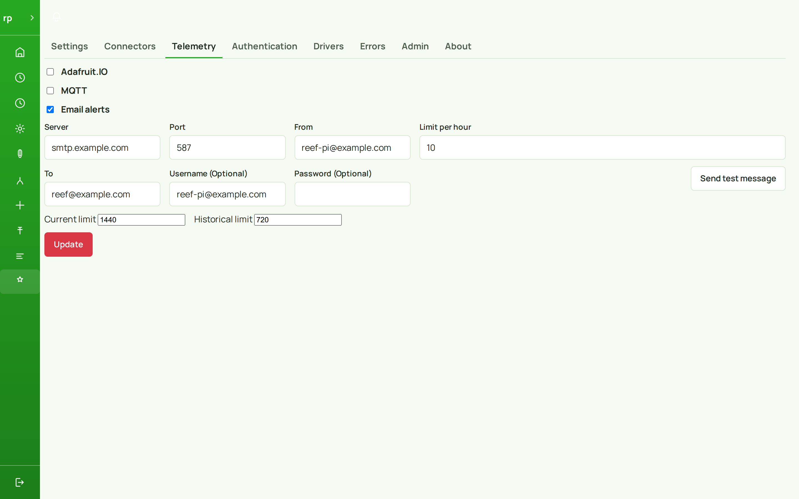
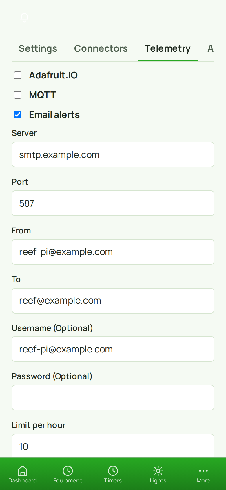

After all the email configuration is saved, click on the **Update** button and reload reef-pi. Once
reef-pi is reloaded, click on the **Send test message** button. You should receive a test email within a
minute or so.

reef-pi can be configured to send alerts as text messages by configuring the To address with the
appropriate SMS gateway email address. For example, in the US, T-Mobile users can use
`<Phone number>@tmomail.net` as the email address to send text messages using emails.

### Concluding Remarks and Next Steps

We covered all the basic features for a reef-pi controller. This will serve as a foundation for the next
set of guides that will incorporate ancillary electronics to control actual equipment and sensors.

reef-pi stores all its data in the file `/var/lib/reef-pi/reef-pi.db`. This file, along with the specific
version of reef-pi which created the database file, can always recreate a reef-pi controller. Older
reef-pi versions are available on GitHub. Thus, users only have to make a backup of the database file
periodically to back up their controller.
