# reef-pi Guide 2: Power Controller

| | |
|---|---|
| Published guide | <https://learn.adafruit.com/reef-pi-power-controller> |
| Author | Ranjib Dey |
| Guide number | 2 (of 7) |
| Screenshots reflect | reef-pi 7.0 (`main`); regenerate with `make guide-screenshots GUIDE=2` |
| Last synced with Adafruit | _not yet_ |

This is the working copy of the Adafruit Learn guide. Readers use the Adafruit page; edits are made
here and copied back by hand (see [the guides index](../README.md)). Hardware photos and diagrams are
linked from Adafruit's CDN (in page order; they are not changing); reef-pi screenshots are generated by
`front-end/e2e/guides/guide-02.spec.js`.

## Changes for 7.0

Copy-back checklist, per Adafruit page.

**Overview, Parts, Circuit Construction, Building The Housing:** no changes (hardware only).

**Configure & Test**

- Image 01 (outlet form under Configuration > Connectors): replace with
  `configure-and-test-01-connectors-new-outlet-{desktop,mobile}.png`.
- Image 02 (eight outlets): replace with `configure-and-test-02-connectors-outlets-{desktop,mobile}.png`.
- Image 03 (new equipment form): replace with `configure-and-test-03-equipment-new-{desktop,mobile}.png`.
- Image 04 (eight equipment): replace with `configure-and-test-04-equipment-list-{desktop,mobile}.png`.
- Image 05 (dashboard grid configuration): **remove**. reef-pi 7.0 has no chart grid to configure.
- Image 06 (equipment chart on the dashboard): replace with
  `configure-and-test-06-dashboard-equipment-strip-{desktop,mobile}.png`.
- Image 07 (timer form): replace with `configure-and-test-07-timer-new-{desktop,mobile}.png`.
- Image 08 (macro form): replace with `configure-and-test-08-macro-new-{desktop,mobile}.png`.
- Image 09 (macro in the list): replace with `configure-and-test-09-macro-list-{desktop,mobile}.png`.
- Text "Head to Configuration section ... click on the connector sub-section" -> "Configuration >
  Connectors", then **+ Add** (or **Add connector**); the outlet form is named as in 7.0.
- Text "Declare 8 equipment ..." -> unchanged; the equipment form now has a **Name** and an **Outlet**.
- Section "Configure Dashboard" rewritten: there is no grid to configure; the Equipment strip along
  the bottom of the dashboard lists every equipment item with an on/off switch.
- Section "Schedule on/off with Timers": the form is described by the 7.0 field names (Function,
  equipment, Action, And Then, After, Schedule).
- Section "Macro": steps are added with **+**; step types are `equipment` and `wait`.

**Needs maintainer check**

- Equipment strip image (06): the strip currently shows every switch off even when equipment is on
  (reef-pi issue #3255). Re-run the screenshots after it is fixed, then turn some equipment on first
  (Eq1, Eq3, Eq4, Eq6 are on in the generated image's setup).
- Timer image (07): the schedule fields cannot be edited yet (reef-pi issue #3257), so the image shows
  the default schedule (`* * * * * 0`), not the guide's "every 10 seconds" (`*/10` in Second). Re-run
  the screenshots after that issue is closed.
- Mobile images show known UI defects tracked in reef-pi issue #3253; regenerate them after it is
  closed, before copying.

## Overview

Welcome to the second guide in reef-pi series.

[See the first part of this series here](https://learn.adafruit.com/reef-pi-guide-1-installation-and-configuration)

In this guide, we will be building a power controller that can turn on/off AC equipment in a variety
of ways (on-demand, timers, macro etc). Think of it as an automated power strip.

This guide assumes you have a working reef-pi installation, if not, start with the first guide. In
the first guide, we have gone through setting up reef-pi on a Raspberry Pi and test the equipment
logic using a simple LED. We'll use the same software configuration with ancillary electronics and
parts to control real AC equipment (like fan, heater, pumps etc.)

## Parts

In addition to a Raspberry Pi to run reef-pi, we'll need a controllable power strip and some ancillary
electronics for the control circuit. The control circuit will be built on top of a
[PermaProto HAT](http://adafru.it/2310) and will be connected to different connectors using jumper
wires. The PermaProto HAT and all the connectors will be mounted on the plastic enclosure using
standoffs.

### Powerstrip

- 1 x [American DJ SR P8 power strip](https://www.amazon.com/dp/B007EYHBVQ/): 8 channel controllable
  power strip
- 1 x [Power supply](https://www.adafruit.com/product/798): 12 V 1A DC power adapter
- 1 x [DB9 cable](https://www.amazon.com/gp/product/B00QM8ZP5E/): DB9 connector wire

### Housing, connectors and standoffs

- 1 x [Nylon standoffs](https://www.adafruit.com/product/3299): standoff to mount Raspberry Pi on housing
- 1 x [DB9 connector](https://www.amazon.com/dp/B073H9BKZ5/): panel mount DB9 connector
- 1 x [Plastic enclosure](https://www.amazon.com/dp/B0723DW8JM/)
- 1 x [Barrel connector](https://www.amazon.com/dp/B01ERPCV1Y): 2.1mm panel mount barrel connector

### Electronics to control powerstrip

- 1 x [ULN2803A](https://www.adafruit.com/product/970): Darlington transistor to control 12V relays
- 1 x [Solid core wire](https://www.adafruit.com/product/1311): for building jumpers on the PermaProto HAT
- 1 x [Perma Proto HAT](https://www.adafruit.com/product/2310): for mounting the ULN2803A
- 1 x [IC socket](https://www.adafruit.com/product/2204): 18 pin IC socket
- 1 x [Male-Female jumper wire](https://www.adafruit.com/product/825)
- 1 x [LM2596 Buck converter](https://www.amazon.com/dp/B07BLRQQK7): 12V to 5V step down converter
- 1 x [Male headers](https://www.adafruit.com/product/3002): short male header pins

## Circuit Construction

### Circuit Details

American DJ SR P8 (the power strip) uses 12V relays to control each of its eight AC outlets. Each of
these relays in turn is represented by one pin in the Line In DB9 connector. We'll use reef-pi to
generate the required 12V control signal for each of the 8 outlets. This signal will be created in the
controller enclosure and exposed via a DB9 connector. We can then connect the enclosure with the power
strip using a DB9 cable.

Internally, reef-pi will use one of the Raspberry Pi's GPIO for each outlet signal. Since Raspberry Pi
GPIO produces 3.3V, we'll use a ULN2803 Darlington transistor to convert it to 12V. ULN2803 is an 8
channel Darlington transistor which works out perfectly.

Following is the pinout of [ULN2803A](https://adafru.it/1azH), we'll connect each of the In pin to a
Raspberry Pi GPIO pin, and Out pin to DB9 connector. COM will be connected to 12V and 0V to common GND
(shared across LM2596, ULN2803A, and Raspberry Pi). ULN2803A is a sink type driver, hence we'll connect
12V power to the GND pin of the DB9 connector.

With the power strip control circuit operating at 12V and Raspberry Pi at 5V, we'll need a power source
for each of these. Though it is possible to power them separately, it's inconvenient. We'll use a
single 12V power supply and an LM2596 buck converter to convert 12V to 5V (you can use a
[12V to 5V UBEC](http://adafru.it/1385) as well).

The LM2596 module allows variable voltage step down using the trimmer. Before wiring it to the rest of
the circuit, tune it to generate 5V output by rotating the trimmer screw. LM2596 modules are cheap and
effective in stepping down anywhere from 30V to 3.3V at 2.5A.

This is the fritzing breadboard view of the entire circuit. We are using a perma proto hat to mount
ULN2803. Notice the DB9 connector exposing 8 12V control signals, and a barrel jack connector for 12V
power source. The ULN2803A circuit is built on top of a PermaProto HAT, which is also used to build a
12V rail to connect the power source (barrel jack), LM2596 input pin, and the DB9 connector's GND pin
(since ULN2803 is a sink type driver).

This entire circuit will be housed inside the enclosure. A female barrel jack connector will be used to
connect the power source with the enclosure, and a DB9 connector for the powerstrip. The ULN2803
circuit will be built on top of a PermaProto HAT.

Before starting soldering or drilling the plastic enclosure, arrange all the main components
(connectors, Pi, PermaProto HAT) to get a tentative idea. We'll use the same arrangement to draw the
drilling holes for the standoffs in the next section.

### Prepare Connectors

All connectors (DB9 and barrel jack) will be wired with the PermaProto HAT using jumper wires. For
this, I start with male-female jumper wires, then strip off the male end, tin it with a soldering iron.

We'll be powering this build with a DC 2.1 barrel jack connector based 12V power supply. A panel mount
female barrel jack connector is fixed on the controller housing.

Solder the jumper wires to the barrel connector. I prefer to use appropriately colored (red for +Ve,
black for GND) jumper wires for individual pins. This simplifies understanding the overall circuit.

To determine the +Ve and GND pins in barrel connectors, I generally plug in the power source and use a
multimeter to identify which pin represents +Ve and GND.

The DB9 connector we are using has screw terminals, we can simply screw in one end of the jumper wire
while the other end can be connected to male headers (that are connected to the ULN2803A output pins).
It's OK to use other types (not screw terminal) of DB9 terminals as well.

### Use PermaProto HAT to Mount ULN2803A

On the Perma Proto HAT, ULN2803 is mounted using an 18 pin IC socket, which is soldered on the HAT. Pi
GPIO pins are connected to ULN2803 input pins using 22 AWG solid core jumper wires. We'll also solder
male header pins for each of the outputs of ULN2803, as well as COM.

Connect 8 individual GPIOs to each of the In pins of ULN2803A.

Solder male header pins to the LM2596 module. We'll use female-female jumper wires to connect the input
pin of this module with the 12V rail on the PermaProto HAT. The output pins will be connected back to
the PermaProto HAT's 5V rail. It is safe to connect all GND together (LM2596 can share a common input
and output GND).

Adjust the LM2596 module for precisely 5.1 V output. For this, connect the 12V power source to the
input pin (use the barrel connector we have built in the earlier step) and a multimeter (with alligator
clip) to the output pin. Rotate the trimmer pot screw till the multimeter indicates 5.1-5.2V. LM2596 is
fairly precise, you should be able to configure exactly 5.1V.

We have not built the housing yet, but for reference, this is the final state we are looking at. You
don't have to follow the exact layout, thanks to the PermaProto HAT's design, there are plenty of other
ways to construct this, as long as the connections are proper (follow the breadboard schematic), we are
good. Notice the 12V rails on the PermaProto HAT, a set of 3 male header pins located in the same
column as ULN2803A pin 10 or COM pin. The right side of the PermaProto HAT has male header pins for
GND. In the build image below, I have passed the red jumper wires beneath the PermaProto HAT to reduce
visual clutter.

## Building the Housing

With the circuit constructed, we'll move on to building the housing. We'll start with a 7x4" plastic
enclosure from uxcell. It does not need to be this specific enclosure, you can choose something else if
you have prior familiarity. Some of the reef-pi users have built their own 3D printed enclosures.

[Large Plastic Project Enclosure Weatherproof with Clear Top](https://www.adafruit.com/product/905):
store your project safe and sound in this nice weatherproof box with a clear top.

We'll be mounting connectors and the PermaProto HAT inside the housing. PermaProto HAT (and Raspberry
Pi) will be mounted using nylon standoffs, while the barrel jack connector or DB9 connector will be
directly screwed in. Arrange all the parts to get an idea and mark the exact locations that need to be
drilled (for connectors or standoffs).

I use a marker pen to highlight the parts that need to be drilled. DB9 connector and barrel jack
connector will be mounted on the side.

PermaProto HAT and LM2596 module will be mounted on the back.

I use a dremel to drill the bigger holes for the DB9 and barrel jack connectors, and a drill driver for
the standoff holes.

That's it. Once holes are drilled, mount all the components and connect the pins with jumper wires.

Test that you are getting 5V on the PermaProto HAT (coming from LM2596) before connecting the
Raspberry Pi. Once tested, connect the Raspberry Pi and your reef-pi controller should be good to go.
Screw in the enclosure lid.

Next, we'll configure the reef-pi UI and test our new power controller.

## Configure & Test

### Declare Outlets

With circuit and enclosure completed, our physical controller is done. Connect the controller with the
American DJ SR P8 power strip using a DB9 cable, connect the DC 12V power source to the controller, and
reef-pi should boot up. Next we'll declare all the outlets and equipment required to test our build.

Head to **Configuration > Connectors** in the reef-pi user interface (UI). We'll create one outlet for
each of the GPIO pins: click **Add connector**, choose the kind **Outlet** and the **Raspberry Pi**
driver, give it a name and pick the GPIO pin. Make sure the GPIO pin numbers reflect our wiring.

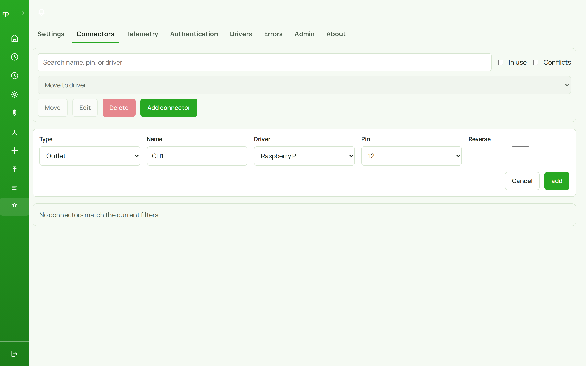
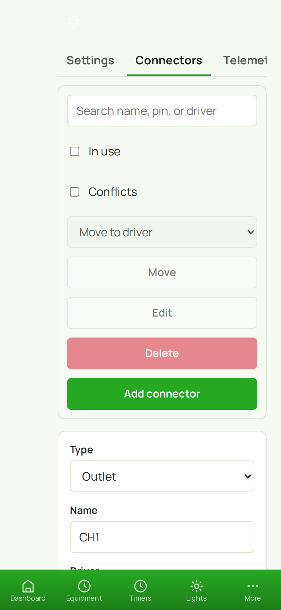

Create one outlet for each of the 8 GPIO pins (the example uses CH1 to CH8 on pins 12, 6, 5, 25, 24,
23, 22 and 27).

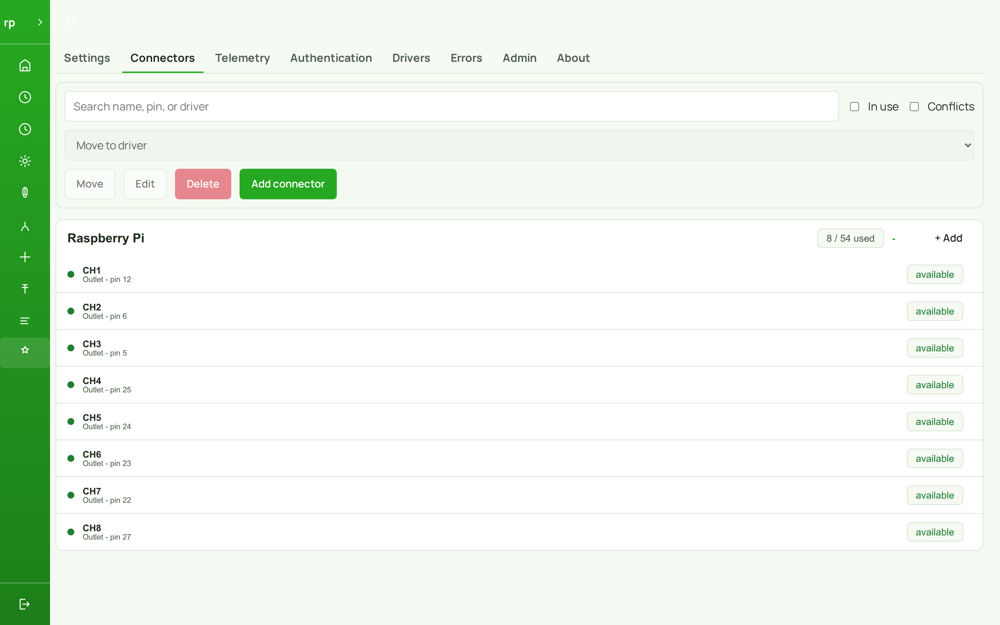
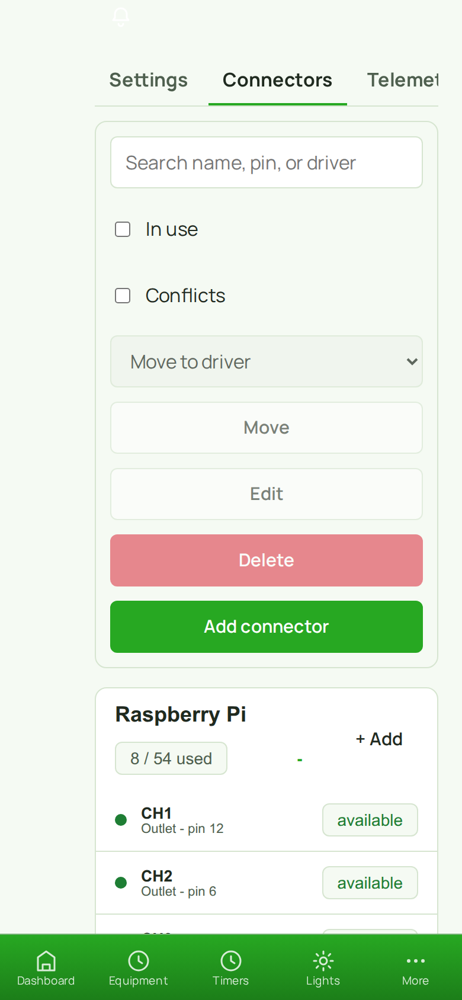

Next we'll create some virtual equipment for testing these outlets.

### Test with Equipment

Open the **Equipment** page and create a virtual equipment: click **+**, give it a name and associate
it with an outlet.

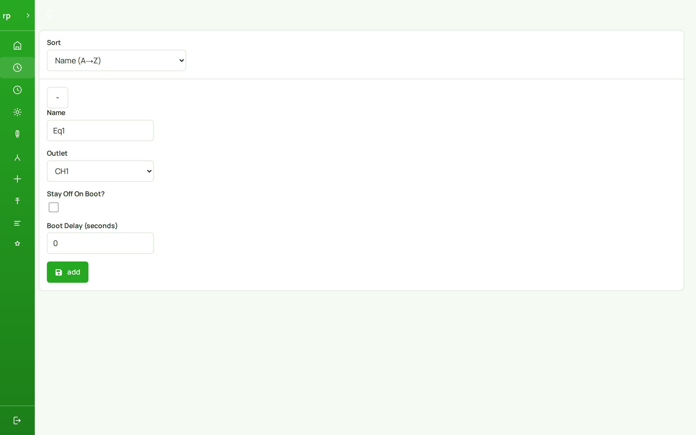
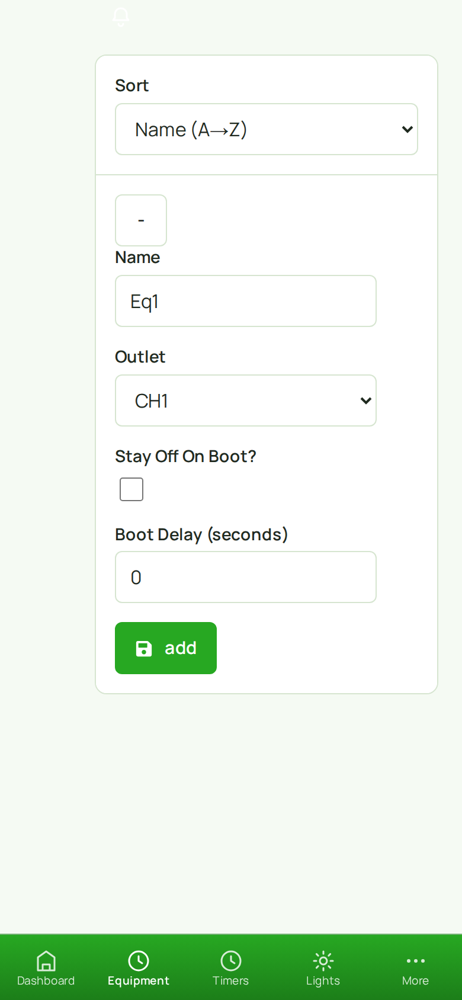

Declare 8 equipment, one for each of the 8 outlets.

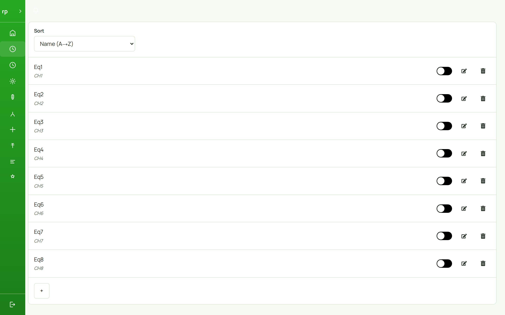
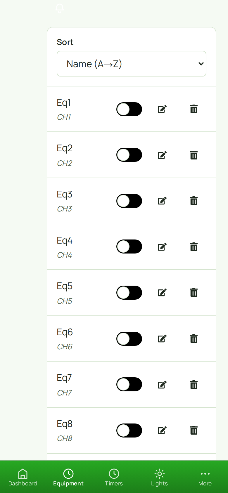

Once all eight equipment are declared, we can click on the on/off switch and reef-pi will turn on/off
the corresponding AC outlet. You should be able to hear the sound of the relay latching on/off.
Validate that each of the AC outlets is indeed turning on/off from the reef-pi equipment UI by plugging
in an AC equipment (such as a table lamp) to the relevant AC outlet in the power strip.

### Dashboard

The reef-pi dashboard shows the current state of your equipment (on or off) in the equipment strip at
the bottom of the page. There is nothing to configure: every equipment item appears there with its own
on/off switch, so you can turn equipment on and off from the dashboard as well.

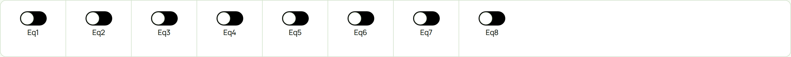
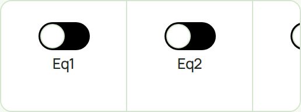

At this point, we can use reef-pi to turn on/off any AC equipment on-demand.

### Schedule on/off with Timers

reef-pi allows controlling AC equipment periodically using timers. Timers are popular to automate
various reef keeping chores (for example light turn on/off at a fixed time every day).

Open the **Timers** page, click **+** and create a timer with the following details. reef-pi uses
[Linux cron](https://adafru.it/Cyg) like grammar to specify timers: Function **equipment**, equipment
**Eq6**, Action **Turn On**, And Then **Turn back off** after **2** seconds, and a Schedule of `*` for
month, day of the week, day of the month, hour and minute, and `*/10` for second.

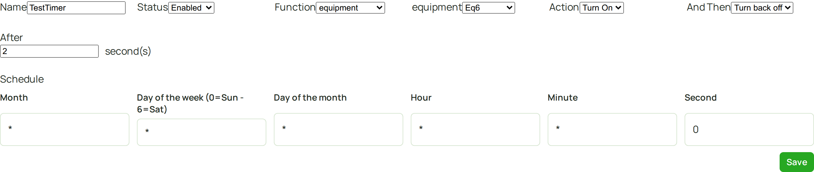
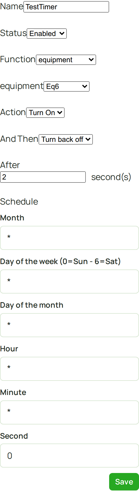

The above timer tells reef-pi after every 10 seconds, turn on equipment Eq6 and then turn it off after 2
seconds. In short, Eq6 will be turned on for 2 seconds after every 10 seconds. Cron is a very powerful
language that allows a variety of periodicity to be expressed concisely.

### Macro

The macro feature in reef-pi allows executing a series of steps sequentially on demand. A step can be
triggering an action against an equipment or waiting. In short, macro allows users to turn a set of
equipment on or off in specific order with a single click of a button. A popular use of this feature is
to automate feed mode or weekly water changes, where pumps in reef tanks are turned off during the
feeding of corals & fish or to replace tank water with clean saltwater. Following is an example of a
macro in reef-pi: it will trigger different actions against different equipment with certain delays
in-between them. Open the **Macro** page, click **+**, name the macro and add steps with the **+**
button.

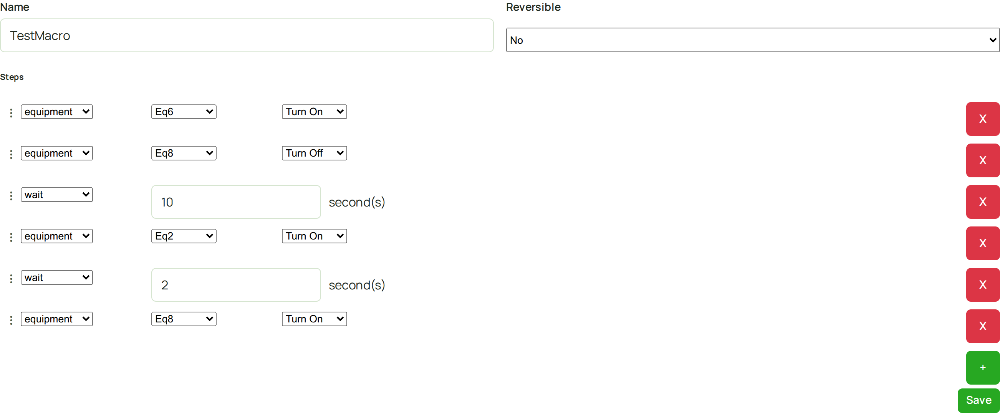
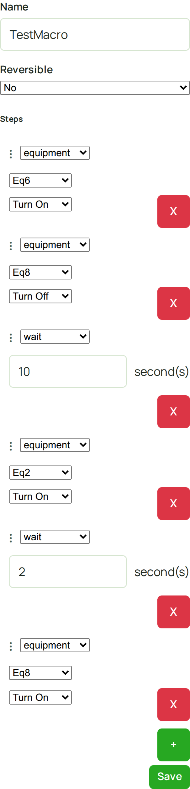

Once declared, this macro can be triggered by a single click of a button.

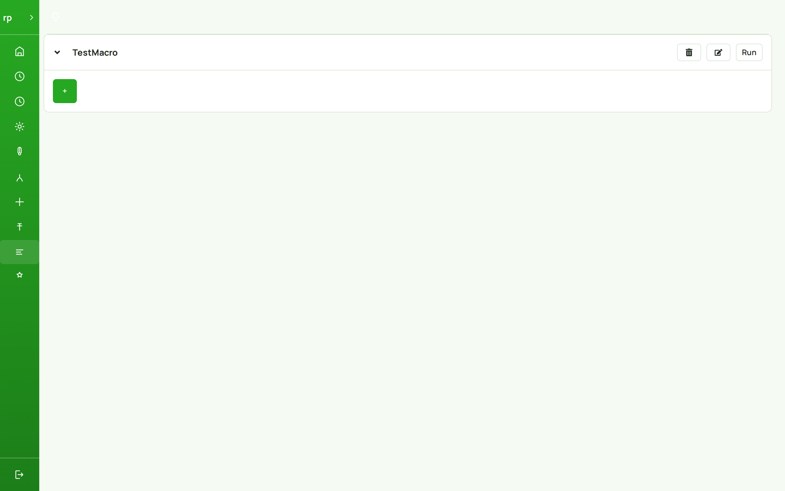
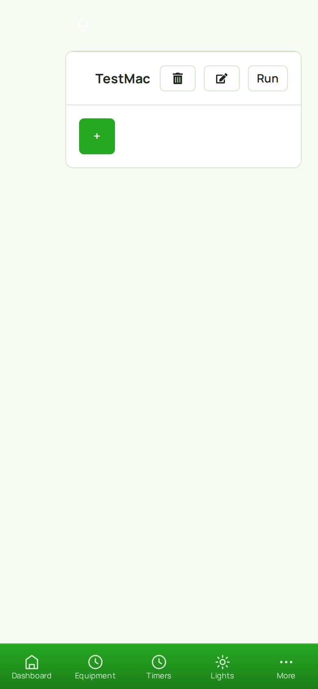

Although reef-pi is aimed for reef tanks, the power controller feature can be used in any general
purpose AC equipment control, like home automation or even making a Christmas lighting controller.

Finally, the power control module is a foundational layer in reef-pi. Other modules, like the
temperature controller and water level controller, require the power controller feature.

In our next reef-pi guide we'll be extending this power controller to monitor temperature and turn
on/off a heater or cooler to maintain a stable tank temperature.
