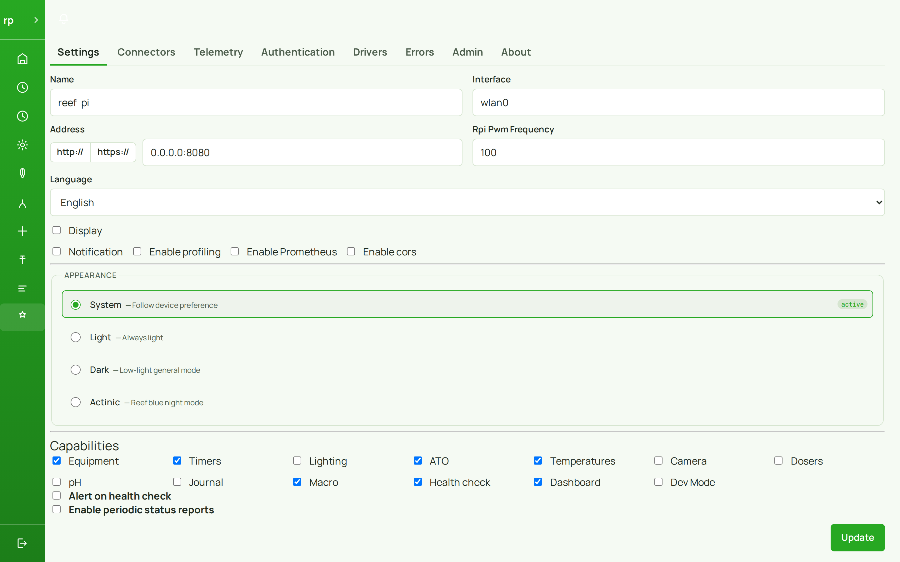
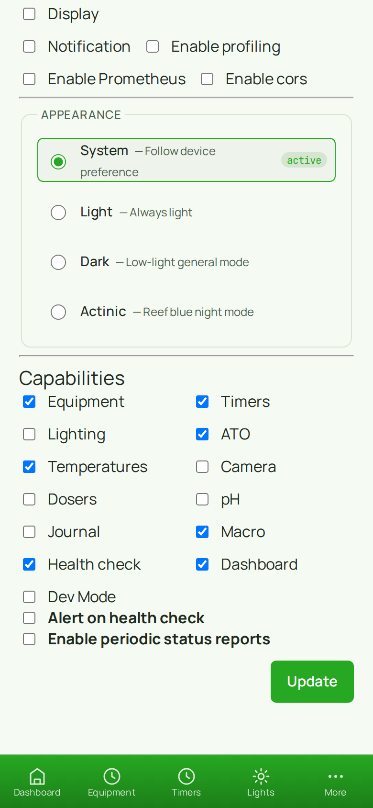
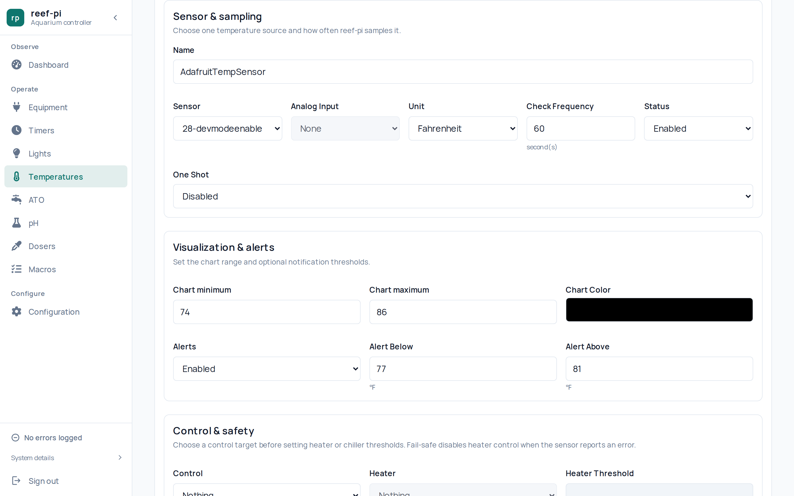
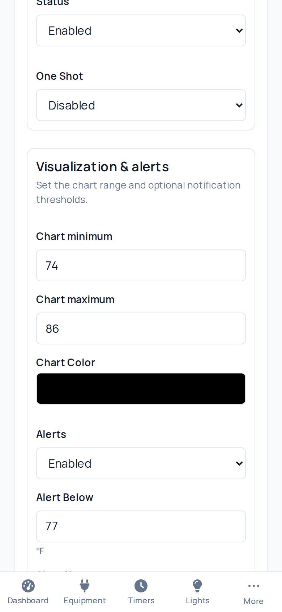
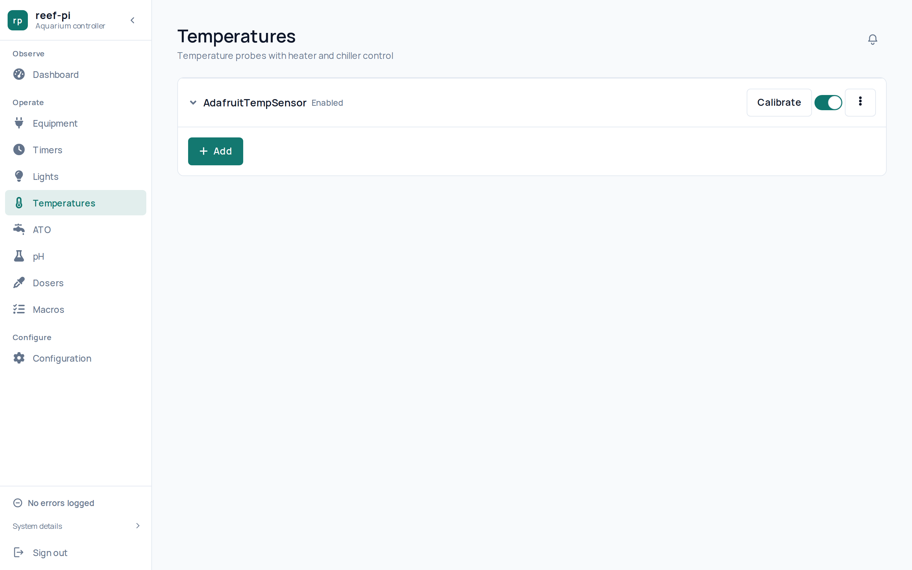
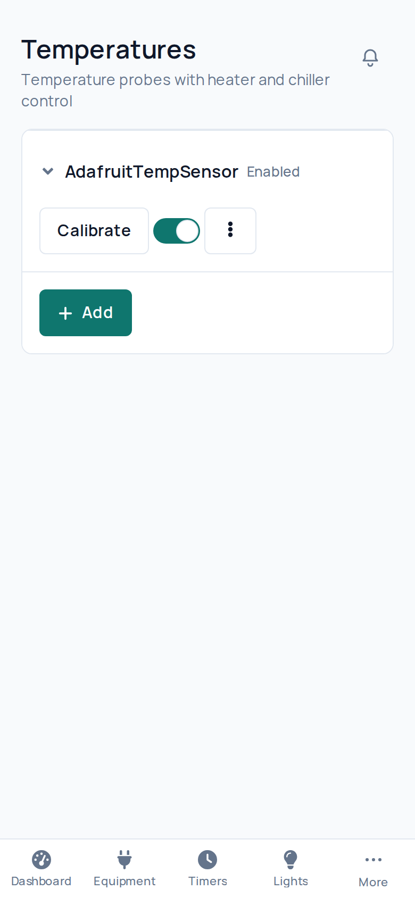
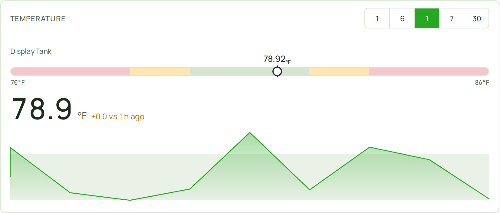
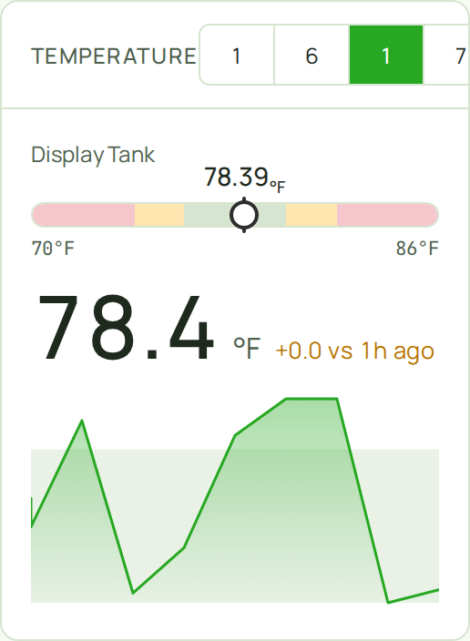

# reef-pi Guide 3: Temperature Controller

| | |
|---|---|
| Published guide | <https://learn.adafruit.com/reef-pi-guide-3-temperature-controller> |
| Author | Ranjib Dey |
| Guide number | 3 (of 7) |
| Screenshots reflect | reef-pi 7.0 (`main`); regenerate with `make guide-screenshots GUIDE=3` |
| Last synced with Adafruit | _not yet_ |

This is the working copy of the Adafruit Learn guide. Readers use the Adafruit page; edits are made
here and copied back by hand (see [the guides index](../README.md)). Hardware photos and diagrams are
linked from Adafruit's CDN; reef-pi screenshots are generated by `front-end/e2e/guides/guide-03.spec.js`.

## Changes for 7.0

Copy-back checklist, per Adafruit page.

**Overview, Parts, Circuit Construction, Building The Housing:** no changes (hardware only).

**Configuration & Testing**

- Image 01 (Settings with the Temperature capability): replace with
  `configuration-testing-01-settings-capabilities-{desktop,mobile}.png`.
- Image 02 (new temperature controller form): replace with
  `configuration-testing-02-temperature-new-controller-{desktop,mobile}.png`.
  It shows alerts enabled at 77 / 81 °F, as the old image did.
- Image 03 (temperature controller list): replace with
  `configuration-testing-03-temperature-controller-list-{desktop,mobile}.png`.
- Image 04 (dashboard chart configuration): **remove**. reef-pi 7.0 shows a Temperature tile on the
  dashboard without configuring a chart grid.
- Image 05 (dashboard temperature charts): replace with
  `configuration-testing-05-dashboard-temperature-tile-{desktop,mobile}.png`.
- Image 06 (Adafruit IO dashboard): unchanged.
- Text "make sure temperature capability is enabled. If not, enable it under the settings section of the
  configuration tab. Reload reef-pi every time settings are updated." -> names the 7.0 locations
  (Configuration > Settings > Capabilities, tick **Temperatures**, click **Update**; then Configuration >
  Admin > Reload) and says "every time capabilities are changed".
- Text "Refresh your browser ... the temperature tab should appear ... clicking on the '+' button"
  -> the Temperature page is reached from the sidebar (on a phone: the bottom bar's "More" menu); the
  form fields are named as in 7.0 (Sensor, Check Frequency, Status, Alerts, Control), "cooling devices"
  -> "chiller devices", and the paragraph now ends with "then click **Save**".
- Text "Once created, the new temperature controller will appear in the list. We can now use this new
  temperature control to chart the sensor data." -> "temperature control" corrected to "temperature
  controller".
- Section "Charts & Dashboard" rewritten:
  - "reef-pi provides two types of charts ... known as temperature ... known as tc" -> "reef-pi keeps
    two kinds of data for each temperature controller"; the retention numbers (1440 recent readings,
    30 days of hourly averages with heater and chiller usage) are unchanged.
  - "Configure the main dashboard to enable both types of temperature chart ... Click on update ...
    Back to dashboard. You should see the temperature charts in the main dashboard now." -> new
    paragraph: the Temperature tile appears automatically (latest reading, gauge, chart, range buttons)
    and expanding the controller on the Temperature page shows its readings and usage charts.
  - "The example images are taken from a controller running for a few days." -> "... running for a
    short time" (the generated images use a few minutes of readings).
- Section "Adafruit IO":
  - "You can enable adafruit.io in the telemetry section under the configuration tab" -> "under
    **Configuration > Telemetry**".
  - "a feed named the same as temperature controller name and with a tc- prefix. This feed will hold"
    -> feed `<prefix><controller name>-reading` (for example `adafruittempsensor-reading`), plus
    `-heater` / `-cooler` feeds when control is on; "These feeds hold".

## Overview

Welcome to the third guide in reef-pi series.

[See the second part of this series here](https://learn.adafruit.com/reef-pi-power-controller)

In this guide, we'll be building a temperature controller using reef-pi. Corals are sensitive to
temperature fluctuations and only survive in specific temperature. Higher order animals, such as
marine fish can withstand much higher temperature fluctuations than coral. Tropical corals thrive at
78 degrees Fahrenheit. In reef aquariums, submersible heaters are used to keep the tank temperature at
78 degrees. For places where the indoor temperature gets really hot, chillers are used to cool down
the aquarium water temperature to the desired level. A temperature controller automates heater and
chiller on/off by sensing aquarium temperature, in turn maintaining a stable aquarium temperature.

Heaters are also prone to failures. Heater failure is one of the most common causes of tank crash
(loss of all tank inhabitants). Temperature controllers can shut down heaters and alert users when
aquarium temperature goes outside a range, providing an extra layer of safety net.

This guide assumes you have a working reef-pi installation with power controller module enabled.

## Parts

Temperature controller module in reef-pi does not require power controller features, i.e. users can
use reef-pi to just monitor and log temperature, but for turning on/off heater or chiller requires
power controller module. In this guide, we'll be extending the power controller.

We'll use submersible DS18B20 temperature sensors for monitoring temperature. The DS18b20 requires
minimal circuit (only a single 4.7K resistor) for integration with Raspberry Pi. We'll use the
existing PermaProto HAT for this. A DS18B20 sensor will be connected to the controller enclosure
using a 3.5 mm audio jack. The probe itself will have a 3.5 mm male audio connector, and the
controller enclosure will have a panel mount female audio jack connector.

Note: Due to our choice of 3.5 mm audio connector, we should always avoid plugging/unplugging the
temperature sensor when reef-pi is running. Always power down reef-pi before connecting or
disconnecting the sensor. The 3.5 mm audio jack causes +Ve and GND pins to be touched (shorted) every
time the male connector is plugged in, causing the Raspberry Pi to reboot (which we do not want to
happen).

reef-pi supports multiple DS18B20 sensors. It is common to use two or three of these for redundancy.
I have tested with up to 7 sensors.

- [Waterproof 1-Wire DS18B20 Digital temperature sensor](https://www.adafruit.com/product/381)
- [Panel Mount 1/8" / 3.5mm TRS Audio Jack Connector](https://www.adafruit.com/product/3692)
- [3.5mm (1/8") Stereo DIY Plug](https://www.adafruit.com/product/1800)
- [Hook-up Wire Spool Set - 22AWG Solid Core - 6 x 25 ft](https://www.adafruit.com/product/1311)

## Circuit Construction

The DS18B20 sensor circuit requires only a 4.7K resistor to work with Raspberry Pi. We'll use the
extra space available in Perma-Proto HAT to mount the 4.7 K resistor as well as three male header
pins which will be used to connect with DS18B20 GND, +Ve and data wires. The sensor itself will be
wired with a male audio jack and will be used to connect with the female audio jack mounted in the
enclosure.

Following is a Fritzing breadboard view of the circuit. Two of the male header pin are directly
connected to GND and 3.3V while the 4.7K resistor is used as a pull-up resistor (from the 3.3V power)
on the data pin, in the center.

Note: though we are using only a single DS18B20 sensor, it is possible to connect multiple sensors (I
have tested with maximum 7 sensors). The wiring remains the same (since the underlying one-wire
protocol is a bus).

### Prepare Connectors

Connect a male audio jack with DS18B20 sensor. Assuming the tip of the male audio jack is upward, the
longest terminal of the jack represents GND, left terminal represents +Ve and the right terminal
represents data. Tin the DS18B20 wires and male audio connector terminals before soldering them
together

This is how the temperature sensor will look once connected with a male audio jack

We'll use a female panel mount audio connector to connect the temperature sensor.

Solder the male end of three male-female jumper wires with the female audio jack. Strip the male end
of jumper wires and tin both jumper wires as well as male audio jack terminals before soldering.
Opposite to the male audio connector, when the female audio connector is arranged upwards, the
longest terminal represents GND, left terminal represents +Ve, and right terminal represents data.
Throughout this build, the data pin is represented by yellow wires which in turn connect to Raspberry
Pi GPIO 4.

### Making DS18B20 circuit

We'll be using 22 AWG solid core wires as jumpers to connect all the pins. The yellow wire is used to
connect GPIO 4 with central male header pin. A 4.7K pull up resistor is soldered perpendicular to
save space.

Since we are extending the power controller circuit, the entire DS18B20 circuit sits on the left side
of the Perma Proto HAT, with ULN2803A (used by power controller circuit) sitting in central location,
occupying bulk of the HAT.

Next, we'll mount the female audio jack in the enclosure.

## Building The Housing

The temperature controller only adds a single audio jack connector to the existing enclosure.
Mounting the female audio connector is fairly easy. Drill a hole in the enclosure using a Dremel or
drill driver. I prefer to keep all the connectors on the bottom side. In this case, the female audio
jack is closer to the input power connector (a 2.1 mm barrel jack)

Re-mount the PermaProto HAT (and Raspberry Pi attached with it) in the enclosure.

The female panel mount audio jack is threaded and comes with a nut to attach it on an enclosure,
which makes it trivial to mount them on these plastic enclosures. Connect the audio jack's jumper
wires with appropriate male header pins.

> **Warning:** Make sure the right header pins and jumper wires are connected. A DS18B20 sensor gets
> really hot and can cause skin burns if the +Ve and GND wires are reversed

That's it, once wired, our temperature sensor module is ready for field testing. Close the enclosure
lid. This is how the end product will look:

Next we'll move on to reef-pi software configuration of the temperature sensor.

## Configuration & Testing

Connect the temperature sensor with the enclosure and power up reef-pi.

> **Caution:** Never connect or disconnect a temperature sensor from the enclosure while reef-pi is
> running. The audio jack connectors short the GND and +Ve pins during plugging/unplugging. This
> causes the Raspberry Pi to reboot. Always power down the reef-pi controller and unplug the input
> power before connecting or disconnecting a temperature sensor.

Once up and running, make sure the temperature capability is enabled. If not, enable it under
**Configuration > Settings > Capabilities** (tick **Temperatures**) and click **Update**. Then reload
reef-pi from **Configuration > Admin > Reload**; reload reef-pi every time capabilities are changed.

| Desktop | Mobile |
|---|---|
|  |  |

Refresh your browser after reef-pi is reloaded and the **Temperature** page should appear in the
sidebar (on a phone, in the bottom bar's **More** menu). Navigate to it and create a new temperature
controller by clicking **Add**. The form groups sensor sampling, visualization and alerts, and
control and safety settings. A new temperature item should be available from the
**Sensor** drop-down (DS18B20 sensors always have a name starting with 28-). The **Status** option
represents whether reef-pi will check this sensor or not. Once enabled, the **Check Frequency** option
represents how frequently (seconds) reef-pi should check for sensor value. Next, the **Alerts** and
**Control** options allow sending an alert if the temperature goes outside a specified range or
turning on heater or chiller devices. For this example, we'll just enable sensor monitoring, then
click **Save**.

| Desktop | Mobile |
|---|---|
|  |  |

Once created, the new temperature controller will appear in the list. We can now use this new
temperature controller to chart the sensor data.

| Desktop | Mobile |
|---|---|
|  |  |

### Charts & Dashboard

reef-pi keeps two kinds of data for each temperature controller. The first is the latest temperature
at check interval granularity: reef-pi will store one days worth of data when check interval is set to
1 minute (1440 values). The second is the hourly average temperature along with heater and chiller
usage (in seconds) for the past thirty days.

There is nothing to configure: as soon as a temperature controller exists, the main dashboard shows a
**Temperature** tile with the latest reading, a gauge, and a chart of recent readings. Use the range
buttons on the tile to switch between the last hour, 6 hours, day, 7 days and 30 days. Expanding the
controller on the **Temperature** page shows its readings and a read-only configuration summary. Use
the controller's action menu to edit or delete it. The example images are taken from a controller
running for a short time; for new builds, the chart shows an empty message until readings arrive.

| Desktop | Mobile |
|---|---|
|  |  |

### Adafruit IO

Other than the in-controller dashboard, reef-pi also allows data logging to the
[Adafruit IO data service](https://adafru.it/fsU). You can enable adafruit.io under
**Configuration > Telemetry**. You'll need to specify your adafruit.io username and AIO Key. Once
enabled, reef-pi will start emitting data to adafruit.io. reef-pi will automatically create a feed
named after the temperature controller with a `-reading` suffix (for example
`adafruittempsensor-reading`, after the optional feed prefix you configure), plus `-heater` and
`-cooler` feeds when control is turned on. These feeds hold the temperature data and can be used to
create a dashboard in Adafruit.io. The following is an example temperature dashboard using Adafruit.io
integration.

Temperature is one of the key requirement for reef aquariums. With this feature, reef keepers will be
able to understand and explore daily and seasonal aquarium temperature variation while having an
extra safety net during heater failure.

In the next guide, we'll build the necessary automation for stabilizing the second most important
parameter of reef aquariums, salinity.
