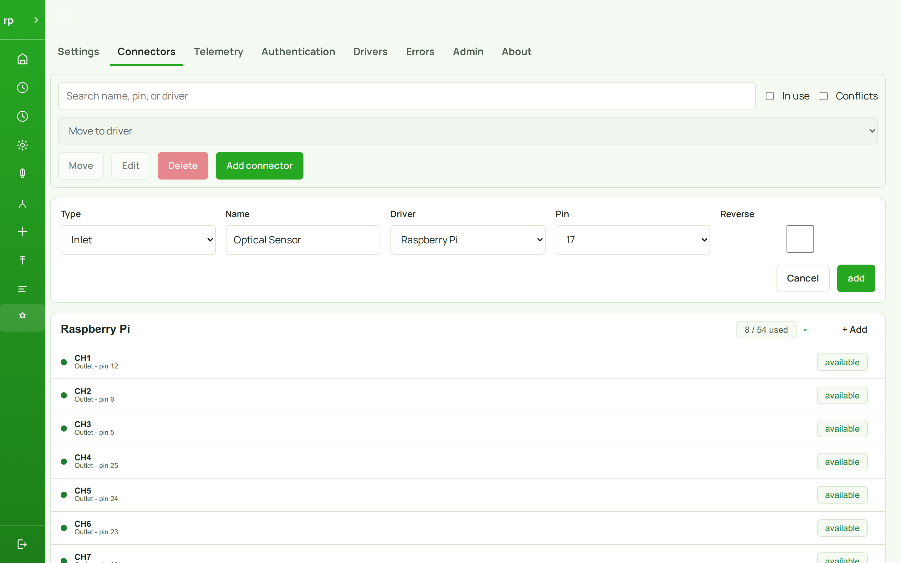
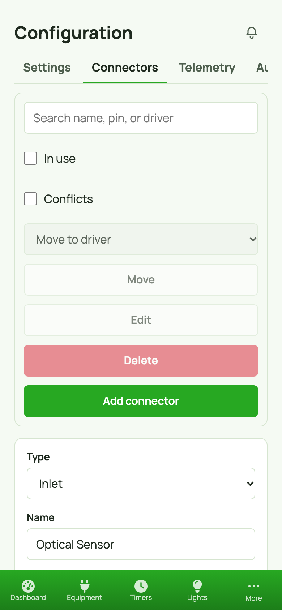
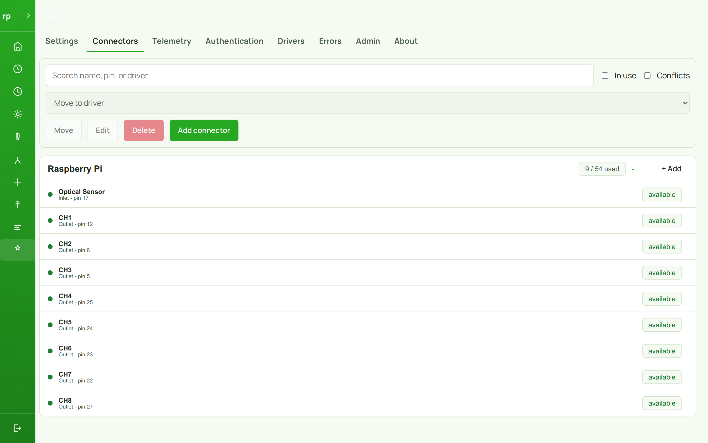
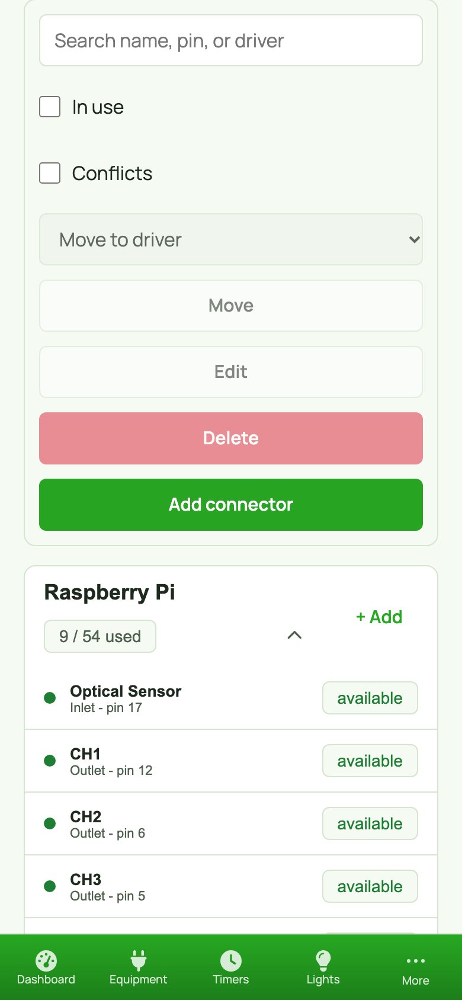
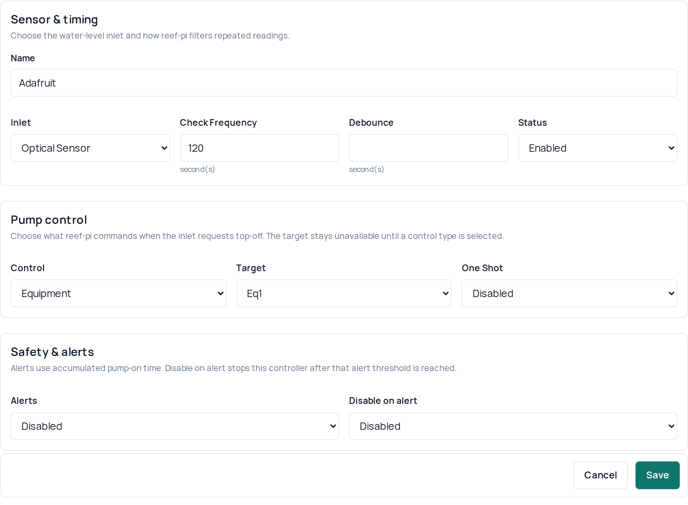
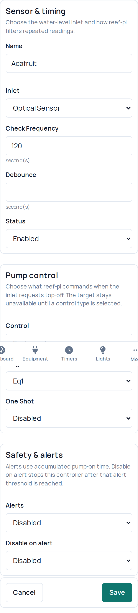
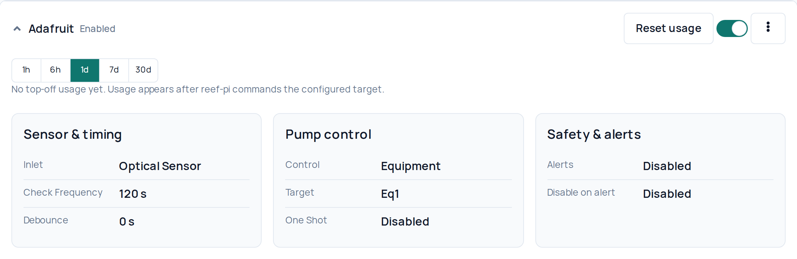
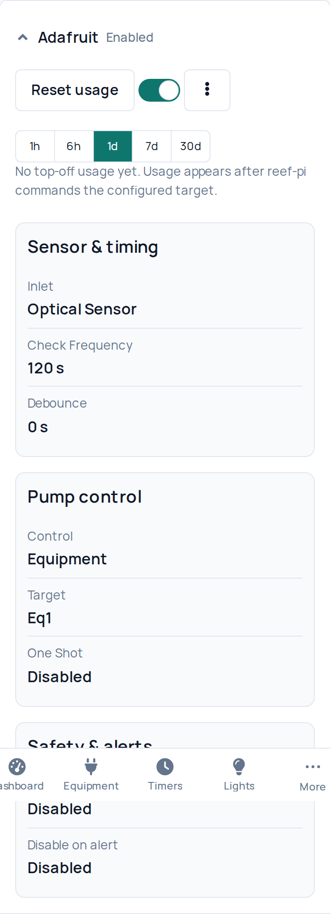

# reef-pi Guide 4: Water Level Controller

| | |
|---|---|
| Published guide | <https://learn.adafruit.com/reef-pi-water-level-controller> |
| Author | Ranjib Dey |
| Guide number | 4 (of 7) |
| Screenshots reflect | reef-pi 7.0 (`main`); regenerate with `make guide-screenshots GUIDE=4` |
| Last synced with Adafruit | _not yet_ |

This is the working copy of the Adafruit Learn guide. Readers use the Adafruit page; edits are made
here and copied back by hand (see [the guides index](../README.md)). Hardware photos and diagrams are
linked from Adafruit's CDN (in page order; they are not changing; the Parts page's product photo is not
mirrored here); reef-pi screenshots are generated by `front-end/e2e/guides/guide-04.spec.js`.

## Changes for 7.0

Copy-back checklist, per Adafruit page.

**Overview, Parts, Circuit Construction, Building The Housing:** no changes (hardware only).

**Configuration & Testing**

- Image 01 (new inlet under Configuration > Connectors): replace with
  `configuration-testing-01-connectors-new-inlet-{desktop,mobile}.png`.
- Image 02 (the inlet in the connector list): replace with
  `configuration-testing-02-connectors-inlets-{desktop,mobile}.png`.
- Image 03 (new ATO form): replace with `configuration-testing-03-ato-new-{desktop,mobile}.png`.
- Image 04 (ATO expanded with its usage chart): replace with
  `configuration-testing-04-ato-expanded-{desktop,mobile}.png`.
- Image 05 (table lamp test photo): unchanged.
- Text "navigate to the connectors section under the Configuration tab. Create a new inlet by clicking on
  the "+" button. Specify a name and GPIO pin number." -> "Configuration > Connectors, click **Add
  connector**, choose the type **Inlet**, name it, leave the driver as **Raspberry Pi** and pick the
  GPIO pin".
- Text "Once created the new inlet will be visible in the UI." -> unchanged; inlets are listed with the
  outlets under the Raspberry Pi driver.
- Text "Next, head over to the ATO tab. Create a new ATO by clicking one "+" button. Associate the newly
  created inlet with it." -> names the form fields as in 7.0: **Inlet**, **Check Frequency** (120
  seconds), **Status**, **Control** = Equipment and **Target** (the ATO pump equipment, `Eq1` in the
  example), then **Save**. The form also has Debounce, One Shot, Alerts and Disable on alert, which the
  guide leaves at their defaults.
- Text "The ATO Status drop-down menu controls whether the ATO will be enabled or disabled." ->
  unchanged.
- Text "We can expand the ATO controller to see the usage chart which shows hourly ATO control pump
  usage in seconds." -> unchanged, but see below.

**Needs maintainer check**

- Image 04: the generated image has no usage chart: a freshly started dev controller has no ATO pump
  usage history, so only the (read-only) settings and the range buttons are shown. Replace it with a
  capture from a controller that has run for a while, or keep the old chart image.
- The reader's example pump is equipment `Eq1` from Guide 2; the old guide's screenshots used a
  different equipment name.

## Overview

Welcome to the fourth guide in reef-pi series. In this guide, we'll be building a water level
controller. In the home environment, reef aquariums lose water due to evaporation. The loss of water
results in an increase in salinity since salt does not evaporate. Natural salt water has a fixed
specific gravity (used to represent salinity) of 1.026. Corals are very sensitive to salinity and a
small salinity fluctuation can cause significant stress to them. To address this, fresh water
(filtered using reverse osmosis and de-ionized) is added to replenish the evaporated water, which in
turn keeps the overall water volume the same, thus keeping the salinity fixed at 1.026. This is called
top off.

While a reef hobbyist can manually top off, a water level controller automates the top off process by
monitoring the reef aquarium water level and pouring fresh water by switching a pump. These types of
controllers are popularly called Auto Top Off or ATO. An ATO is critical for keeping salinity at exactly
1.026 in smaller aquariums.

This guide assumes you have a working reef-pi setup along with the power controller module. Follow the
[first two guides](https://learn.adafruit.com/reef-pi-power-controller) if you have not. We'll be
extending our previous power controller build to add an optical water level sensor and a water pump
(connected via the American DJ SR P8 power strip) to pour fresh RO/DI (reverse osmosis, de-ionized)
water into the aquarium. Although in this guide we are extending our temperature & power controller, it
is also possible to build a standalone ATO controller using reef-pi.

## Parts

We are extending the [temperature controller](https://learn.adafruit.com/reef-pi-guide-3-temperature-controller)
that we have built in the course of the last three guides. We'll extend the main circuit built on
Perma-Proto HAT to provide three male jumper pins that will be connected with the optical sensor
breakout board.

- 1 x [Water level sensor](https://www.dfrobot.com/product-1470.html): infrared water level sensor with
  breakout board. We'll be using this optical water level sensor breakout board from DFRobot that
  simplifies the integration of the optical sensor with the GPIO pins of the Raspberry Pi.
- 1 x [ATO water pump](https://www.amazon.com/dp/B0713T9PRP/): water pump to pour RO/DI water from the
  ATO container to the reef tank
- 1 x [Power adapter](https://www.amazon.com/dp/B0713T89R1/): 12V power adapter for the ATO pump

## Circuit Construction

The optical sensor breakout board requires a three pin connection using 5V, GND and any of the
available GPIO on the Raspberry Pi.

Following is the required circuit:

With power controller circuit:

We'll solder three male header pins for connecting the breakout board. Notice the green colored solid
core wire is connecting pin GPIO17 with one of the male header pins. The other two pins are connected
to GND and the 5V rail.

Closeup photo of the ATO circuit. Notice the temperature circuit (for DS18B20 sensor) is located right
above the ATO circuit.

It is perfectly fine to use a separate Perma-Proto board (my personal favorite is the
[mint tin size](http://adafru.it/723) Perma-Proto board) if you find the Perma Proto HAT is too crowded.

That's it. Like most of the reef-pi electronics, the ATO circuit is really simple. Next, we'll go ahead
and mount it along with the optical sensor breakout board in the housing.

## Building the Housing

Here we'll be mounting the optical sensor breakout board in addition to all the electronics that's
already present in our reef-pi build. For this, start with locating the DFRobot breakout board at the
bottom of the housing. I generally wall mount the reef-pi housing and prefer to keep all connectors
(temperature sensor, pH sensor, power strip connector, etc.) at the bottom panel of the housing.

Draw the outline of the breakout board along with locations for standoffs, and then drill holes using a
Dremel or drill driver. The optical sensor breakout board uses a 4 pin JST connector, hence we'll make a
rectangular hole for it. I use a file to smooth out the edges after making the initial hole with a
Dremel.

Ignore the other two round holes present on the right-hand side of the housing for the time being, they
are made to accommodate an extra temperature sensor and light controller connector. They will be used in
the next build. I was lazy, so I did the drilling in one step :-)

In addition to the rectangular hole for the optical sensor's JST connector, drill holes for fixing the
breakout board with nylon screws. The breakout board has two holes for mounting. Once the necessary
holes are made, fix the breakout board with nylon screws.

Wire everything up. Notice I have passed the optical sensor breakout board 3 wire ribbon from beneath
the Perma-Proto HAT. Make sure 5V (red), GND (black) and GPIO 17 (green) wires are connected correctly.

Here is a close up of the build with the optical sensor attached, along with the rest of the sensors and
connections. That's it, the reef-pi ATO build is complete. Next, we'll go through the configuration and
testing of our ATO controller.

## Configuration & Testing

Power up your reef-pi controller once all the sensors are connected alongside the power strip. Connect
reef-pi to your computer and go to the reef-pi user interface (UI) to configure the new ATO controller.

Digital inputs, such as optical sensors, are represented as inlets in reef-pi. Inlets are then
associated with ATO controllers to monitor the water level sensor and turn on or off the ATO pump (a
submersible or peristaltic pump, declared as an equipment in reef-pi).

To create an inlet, open **Configuration > Connectors**. Click **Add connector**, choose the type
**Inlet**, give it a name and pick the GPIO pin number. In our case the GPIO pin number is 17. I am
naming the inlet "Optical Sensor".

> Inlets and Outlets in reef-pi are always associated with GPIO pin numbers. These are not serial
> numbers of the pins (for example the GPIO 17 pin is the 11th pin).

Once created, the new inlet will be visible in the UI.

Next, head over to the ATO page. Create a new ATO by clicking **Add**. The form separates sensor and
timing, pump control, and safety and alert settings. Associate the newly created inlet with it. We'll
name it Adafruit. Notice the default check frequency is set to 120
seconds. This means reef-pi will check the inlet (the optical sensor in this case) every 120 seconds
and switch the control pump on or off if specified. Choose **Equipment** as the control and pick the
pump's equipment as the target. The **Status** drop-down menu controls whether the ATO will be enabled
or disabled. Click **Save**.

Once created, the ATO controller will start monitoring the inlet. Since the optical water level sensor
is out of water, the ATO control pump will be turned on. Expand the ATO controller to see its read-only
sensor, pump, and safety summary. Its usage chart shows hourly ATO control pump usage in seconds once
data is available; a new controller shows an empty message first. **Reset usage** clears that history,
and the action menu contains Edit and Delete.

For more comprehensive physical testing, use a table lamp or any other suitable AC device to simulate
turning on a control pump and a cup of water to simulate the water level changes. Reduce the ATO
control frequency to a smaller check interval (for example 2 seconds). Now, if you submerge the optical
water level sensor inside the cup of water, the table lamp should turn off within a couple of seconds
and if the optical water level sensor is moved out of water reef-pi should turn on the table lamp.

The ATO controller in reef-pi is built by connecting an inlet item with an equipment item. Though it is
built for water level control (and salinity indirectly) it can be used to automate a host of things,
since mechanical switches, float switches, etc. can also be used as inlets.

A lower check interval will cause higher CPU usage in reef-pi. reef-pi allows charting CPU and memory
usage (enable the health check feature in configuration). Keep a watch on those graphs to understand
if your controller is loading your CPU.

Thank you for reading through the water level controller guide. We'll go through the lighting
controller in the next reef-pi guide.
