# reef-pi Guide 5: Light Controller

| | |
|---|---|
| Published guide | <https://learn.adafruit.com/reef-pi-lighting-controller> |
| Author | Ranjib Dey |
| Guide number | 5 (of 7) |
| Screenshots reflect | reef-pi 7.0 (`main`); regenerate with `make guide-screenshots GUIDE=5` |
| Last synced with Adafruit | _not yet_ |

This is the working copy of the Adafruit Learn guide. Readers use the Adafruit page; edits are made
here and copied back by hand (see [the guides index](../README.md)). Hardware photos and diagrams are
linked from Adafruit's CDN (in page order; they are not changing; the Parts page's product photos are not
mirrored here); reef-pi screenshots are generated by `front-end/e2e/guides/guide-05.spec.js`.

## Changes for 7.0

Copy-back checklist, per Adafruit page.

**Overview, Parts, Circuit Construction, Building The Housing:** no changes (hardware only).

**Configuration & Testing** (the page has eight images; match them by position)

- Image 1 (jacks under Configuration > Connectors): replace with
  `configuration-testing-01-connectors-new-jack-{desktop,mobile}.png` (the form) and
  `configuration-testing-02-connectors-jacks-{desktop,mobile}.png` (the declared jacks).
- Image 2 (new light with the jack menu): replace with
  `configuration-testing-03-light-new-{desktop,mobile}.png`.
- Image 3 (the lights): replace with `configuration-testing-04-lights-list-{desktop,mobile}.png`.
- Image 4 (fixed profile): replace with `configuration-testing-05-light-fixed-profile-{desktop,mobile}.png`.
- Image 5 (diurnal cycle in Adafruit IO): unchanged.
- Images 6-7 (auto profile): replace with one image,
  `configuration-testing-06-light-auto-profile-{desktop,mobile}.png`, and delete the other.
  **Check this against the live page**: which of the two old images shows the profile editor was not
  verifiable from the page source.
- Image 8 (dashboard configured to chart the light profile): **remove**. reef-pi 7.0 has no chart grid to
  configure and the dashboard has no light chart.
- Text "declare jacks under the Connectors section in Configuration tab" -> "Configuration > Connectors:
  click **Add connector**, choose the type **Jack**, set the driver to **pca9685**, name it and enter
  the pins as a comma separated list (`0,1`)". Make sure the driver is pca9685: the form defaults to
  Raspberry Pi.
- Text "There are three Kessil connectors, J1 to J3, connected to pin 0, 1 and 2,3 and 4,5 respectively"
  -> unchanged (pins `0,1`, `2,3`, `4,5`; the actinic strip on pin `12` as jack J4).
- Text "create lights and associate the relevant jacks with the lights" -> Lights page, **+**, a name and
  the jack from the **Jack** menu, then **add**.
- Profiles: 7.0 lists Fixed, Interval, Diurnal, Random, Sine, Lunar, Circadian, Cyclic, Lightning and
  Solar. The guide's "auto profile" is now called **Interval**; the light's list row shows an **Auto**
  button, and the profile is chosen per channel when the light is edited.
- Text "The diurnal profile cannot be visualized in the reef-pi dashboard itself" -> unchanged.
- Text "We can configure the reef-pi dashboard to show the light profile in "auto"" -> **remove** the
  paragraph with image 8 (see above).

**Needs maintainer check**

- On phones the jack menu on the Lights form opens partly off-screen and stays open over the form
  (reef-pi issue #3268), so the mobile image 03 shows the form with the jack already chosen; the menu is
  not shown. Re-run the screenshots after the issue is closed.
- The channel colour swatches are black: the lights created from the form have no colour set. The old
  screenshots showed real colours (they had been customised).
- Intervals: the guide's auto profile example (values per two-hour step) is not reproduced; the image
  shows the default interval editor with all steps at 0.

## Overview

Welcome to the fifth guide in the reef-pi series.

In this guide, we'll use reef-pi to automate a reef aquarium lighting. This guide assumes you have read
through [the first guide](https://learn.adafruit.com/reef-pi-installation-and-configuration) in this
series.

Lighting is one of the most critical aspects of reef keeping. Corals feed on light. Although corals are
animals (thus they cannot do photosynthesis), they have zooxanthellae (a type of algae) in their tissue
that forms a symbiotic relationship with them. The algae provide nutrition to the host coral via
photosynthesis, while the corals provide the entire habitat for the algae. Tropical corals can survive
solely on photosynthesis, though they can also do filter feeding from the water column.

Light controllers in reef keeping are used to mimic natural reef environment. We'll be using reef-pi to
automate the dawn to dusk daylight cycle. Light controllers are also used during the introduction of
new corals in the aquarium. Corals are very sensitive to changes in general, and when new coral is
introduced in reef aquariums, it is helpful to set up proper light acclimation where light intensity is
slowly ramped up to target levels, to reduce the new coral's stress and increase the chance of survival
and reduce accidental bleaching.

Sometimes, moonlight or UV lights are used to simulate the lunar cycle. Coral spawning (sexual
reproduction of corals by releasing spores) is closely linked with the lunar cycle. Corals contain
fluorescent pigments which glow under UV lights. Oftentimes, reef keepers will use UV lights for their
viewing pleasure, outside the daylight cycle time.

In the reef aquarium, lighting requires a light source of a specific wavelength (around 460 nm) and
intensity (50-200 PAR). Typically reef aquariums require 3-5 watts of light per gallon. There are a
number of popular LED lights available for reef aquariums. It is also possible to build a light from
scratch using appropriately chosen diodes (generally Cree or Luxeon). In this guide, we'll build a
controller for one of the popular LED lights, Kessil, as the main light and an actinic LED strip for
moonlight. Although the example circuits are for these specific lights, they should be fairly useful for
a host of other commercially available light controls.

Due to the various requirements of light controls and diverse nature of LED lights, reef-pi's light
control features are extensive compared to other reef-pi modules. To explore reef-pi light control
features, we'll build a dedicated light controller as part of this guide. This controller will automate
three Kessil lights (A80, A160, A360) as the main light source for the reef aquariums and a single
moonlight strip from TrueLumen, which is mostly used for viewing pleasure, during night time when the
main light (Kessil) is off. This build is very much customized for my tanks, as shown below, but the
technique should be fairly applicable to most other reef tank setups.

## Parts

For one part of the build, we'll extend our previous reef-pi build to control Kessil lights (A360, A80
or A160). Kessil allows controlling the spectrum and intensity of the light using 10V pulse width
modulation (PWM). We'll use the Raspberry Pi's hardware timers as a 3.3V PWM source which will then be
converted to a 10V PWM using an NPN transistor. We'll use a couple of LM2596 modules to generate 5V (for
Raspberry Pi) and 10V (for NPN transistor source) power sources from a single 12V power source.

For the other build, we'll aim to control multiple Kessil lights as well as a moonlight from Coralife.
We'll need 7 (3x2 +1) PWM channels for this build. We'll use a new Pi Zero along with the Adafruit
PCA9685 breakout board (since the Raspberry Pi has only two hardware based PWM channels, while the
PCA9685 has 16 PWM channels).

This parts list does not include the actual lights (Kessil or Coralife).

- 8 x [NPN Transistor](https://www.adafruit.com/product/756): common NPN transistor
- 8 x [10K resistor](https://www.adafruit.com/product/2784)
- 8 x [1K Resistor](https://www.adafruit.com/product/2782)
- 1 x [PCA9685 Breakout board](https://www.adafruit.com/product/815): 16 channel PWM
- 1 x [Raspberry Pi Zero W](https://www.adafruit.com/product/3400)
- 1 x [Perma Proto board](https://www.adafruit.com/product/1609)
- 1 x [Small mint tin size Perma Proto Board](https://www.adafruit.com/product/1214)
- 1 x [Enclosure](https://www.amazon.com/dp/B0723DW8JM/): enclosure for the circuit
- 1 x [Power adapter](https://www.amazon.com/dp/B01LSETT30): 12V 2A regulated power supply
- 1 x [Switch](https://www.adafruit.com/product/917): SPDT switch to turn power down or up
- 1 x [Power MOSFET](https://www.adafruit.com/product/355): logic level N-channel power MOSFET
- 1 x [Male-male audio cable](https://www.amazon.com//dp/B00R10DWWK): cable to connect Kessil lights with the controller
- 1 x [22 AWG Solid core wire](https://www.adafruit.com/product/1311): hook-up wire for creating jumpers
- 3 x [3.5mm TRS jack](https://www.adafruit.com/product/3692): audio jack to connect with Kessil lights
- 1 x [Nylon standoffs](https://www.adafruit.com/product/3658): to mount all electronics in the enclosure
- 1 x [Male 2.1mm barrel jack](https://www.adafruit.com/product/3310): barrel connector to power the actinic LED strip
- 1 x [Female panel mount barrel jack](https://www.amazon.com/dp/B073TS9H3S/): for the main controller power source
- 2 x [LM2596 Buck Converter](https://www.amazon.com/dp/B07VVXF7YX?th=1)

## Circuit Construction

A light in reef-pi is composed of one or more channels. Each channel is controlled by a jack, a type of
connector (similar to outlets or inlets) that represents a DC current source with PWM capability. The
lighting circuit in reef-pi determines how many jacks are available and their supported voltage/current
range. For our light controller, we are aiming for 3 Kessil light controls and a blue actinic LED strip
for moonlight. Each of the Kessil light controls requires two 10V PWM control signals and the blue
actinic LED strip will require one more, which makes our total number of required jacks at 7.

We'll be using the Adafruit PCA9685 breakout board which offers 16 channels, more than enough for our
use. For each channel, we'll use a basic circuit where the 5V PWM signal will be generated by the
PCA9685 IC and then a transistor will be used to convert that PWM signal to an appropriate voltage and
current for the specific light. Kessil lights have dedicated 10V PWM control inputs which are different
from the actual power source, which makes the control signal current requirement fairly low (under
20mA). We'll use a common NPN transistor 2N2222A for this. There will be six total transistors to
support all 3 Kessil lights, each with two channels. For the actinic LED strip we'll use a
[TrueLumen actinic LED strip](https://adafru.it/COz) and dim it by controlling its power source directly
using a power MOSFET.

Here is an overall schematic of the wiring. We'll use a single 12V 2A power supply to power the entire
project. Two LM2596 modules will be used to generate 5V (for Raspberry Pi & PCA9685 breakout board) and
10V (for Kessil circuit) power sources from a single 12V rail. The 12V rail will be used to feed the
actinic strip as well, connected via a 2.1mm barrel jack connector.

Notice there are two perma proto boards used in this build. A half size perma proto board has the
Kessil control circuit, which involves one NPN transistor for each channel, the PWM output from the
PCA9685 IC is connected to the transistor base (green wire) with a 10K resistor in series. While the 10V
rails are connected to the collector pin (blue wire) of the transistor with a 1K resistor in series. The
emitter pin of the transistor is connected to GND.

The power MOSFET based control circuit for the 12V actinic LED strip is mounted on a small Mint Tin size
perma proto board. A common N channel logic level power MOSFET is used, with the PCA9685 PWM output
connected to the Gate pin (green wire), the Source pin connected to the -Ve end of the LED strip (blue
wire) and the Drain pin connected to GND.

Start with preparing all the connectors. We'll need two barrel jack connectors, one for the incoming 12V
2A power source and another for powering the actinic LED strip. We'll also use an SPDT switch for
convenient power up or power down of the controller.

Prepare three panel mount female audio jacks by soldering female jumper wires on them. We'll use each
one of them to control one Kessil light. We'll need three such connectors for this build.

We'll need two LM2596 modules. For this build, I am using the LM2596 module with female jumper wires
soldered on them directly.

Always tin the connectors and the jumper wires before soldering.

Next, build the Kessil control circuit on the half size Perma Proto Board. I have used color-coded male
header pins and jumper wires to make it easy to understand the circuit. The green header pins represent
the inbound 5V PWM signal from the PCA9685. They are in pairs, since each Kessil light has two
controllable channels. The blue header pins are for 10V PWM that will be generated by the transistor.
Each of the light control signals involves two 10V PWM channels and a GND.

Add NPN transistors and resistors. Then solder the jumper wires and male header pins for power rails. I
use 22AWG solid core wires for this. The upper power rail is used for 5V and the lower power rail is
used for 10V.

> You don't want to mix the upper power rail lines with the lower ones as they are at different
> voltages in this build.

Next, build the actinic LED strip control circuit on the Mint Tin size Perma Proto Board. This board
will also provide a 12V that is used to power the LM2596 modules. The actinic LED strip comes with bare
wires. Connect with a 2.1 mm male barrel connector.

## Building the Housing

Start with drilling holes for all the connectors. I prefer to mount connectors at the bottom of the
panel. Note the barrel jack connector holes (the first two on the left) are a little bit bigger than the
holes for 3.5mm audio jacks (right three holes).

Drill a hole for the SPDT switch that will be mounted on the side panel and proceed to mount the
electronics. I start with the PCA9685 breakout board. All the breakout boards, Pi and Perma Proto boards
are mounted using nylon standoffs. I tend to place them inside the enclosure first, then mark down their
PCB holes and then drill the enclosure on those spots to screw fit the standoffs.

The LM2596, Pi and the Perma Proto boards are mounted. SPDT switch, power source and LM2596 input power
pins are all connected.

The rest of the pins are then connected with female-female jumper wires. I sometimes resize them by
manually stripping them off and connecting dupont female connectors of the appropriate length. I also
use color-coded heat-shrink tubes just to group similar connections. In this build, the PCA9685 PWM
outputs are connected with jumper wires in the yellow heat-shrink tube and the 10V PWM outputs are
grouped in the green heat-shrink tube. The blue heat shrink tube groups the i2c jumper wires (SDA, SCL)
that connects the Raspberry Pi with the PCA9685 breakout board. Use the
[Adafruit guide on PCA9685](https://adafru.it/COA) to get started with this versatile chip if you are
not familiar with it.

That's it, our reef-pi light controller is built. Here is a side view of the controller showing the SPDT
switch, and the bottom side view, showing all the connectors. Leftmost is the 12V 2A power input, then
the 12V PWM power output for the actinic LED strip and then three 3.5mm audio jack connectors for Kessil
lights, each having two 10V PWM control signals.

Next, we'll power up this build and learn how to use reef-pi software features to automate the lights.

## Configuration & Testing

Before powering up the entire build (the Raspberry Pi in particular), make sure the LM2596 modules are
correctly tuned to generate exactly 5 and 10V output. Crosscheck with a multimeter that the power rails
on the half size Perma Proto board (5V above, 10V down) as well as the mint tin size Perma Proto board
(12V) are as expected.

Once everything is as expected, connect the Raspberry Pi power pin (Pin 2) at the end and power up
reef-pi.

Once reef-pi is running, go to the UI and declare jacks under **Configuration > Connectors** to
represent all four connectors: click **Add connector**, choose the type **Jack**, set the driver to
**pca9685**, give it a name and enter its pins. There are three Kessil connectors, J1 to J3, using pins
`0,1`, `2,3` and `4,5` respectively. I am using PCA9685 pin 12 (jack J4) to control the power MOSFET.

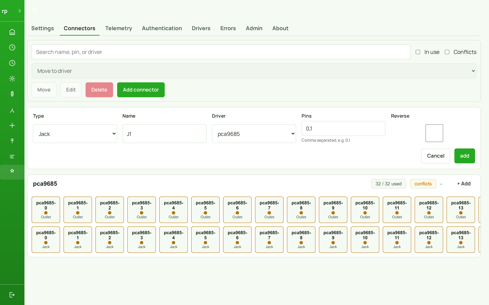
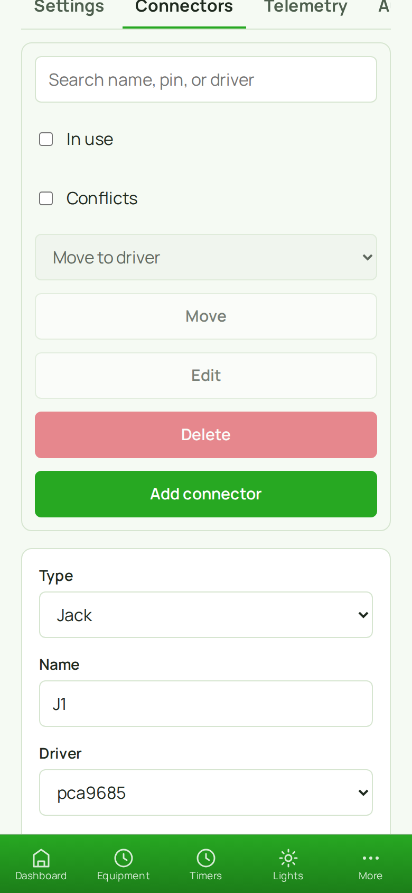
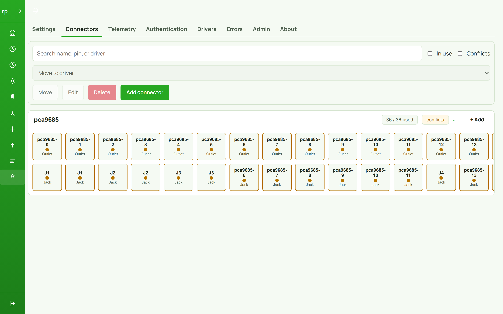
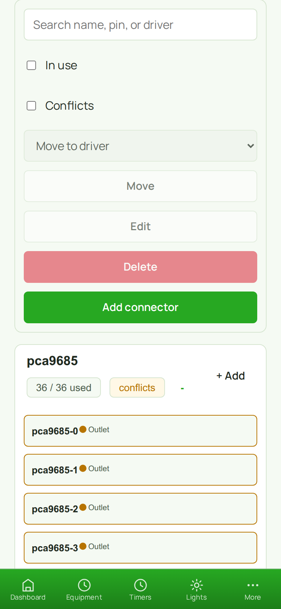

Next, create lights and associate the relevant jacks with the lights: open the **Lights** page, click
**+**, enter a name and choose the jack from the **Jack** menu.

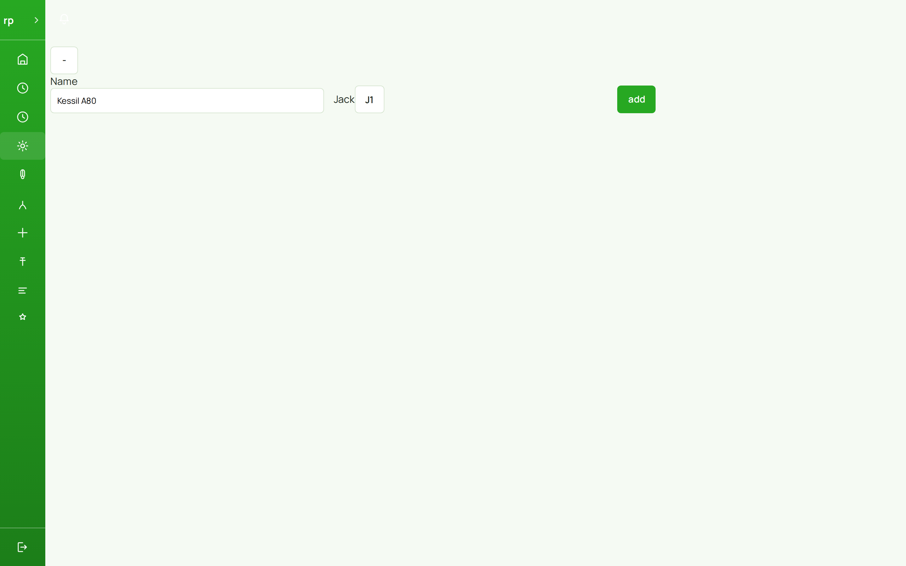
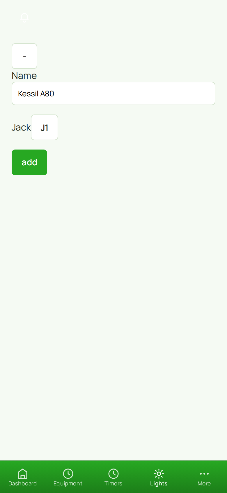

Next, create four lights to test all the connectors. I am declaring my three Kessil lights and the
moonlight, for example.

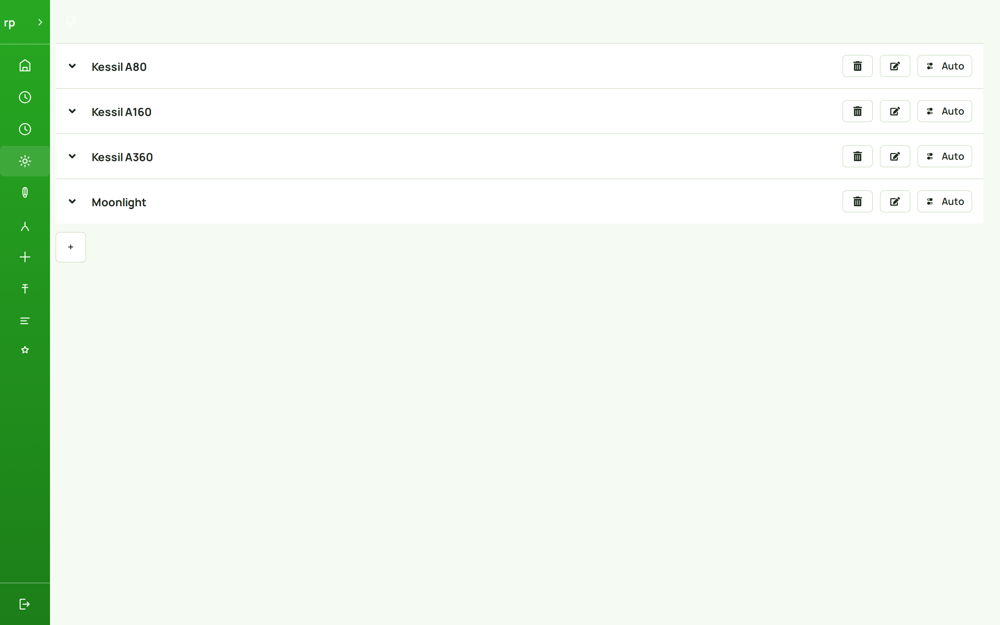
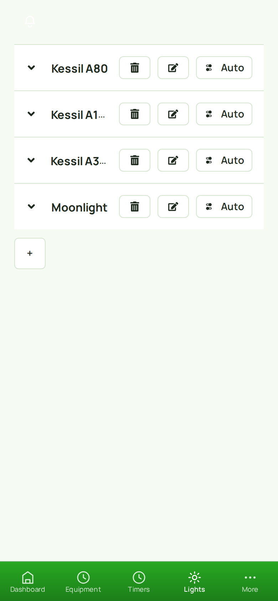

Once created each light can be controlled independently using profiles.

The fixed profile allows running lights at a constant brightness or color. This is generally useful for
creating on-demand moonlights or during photo shoots of the tank.

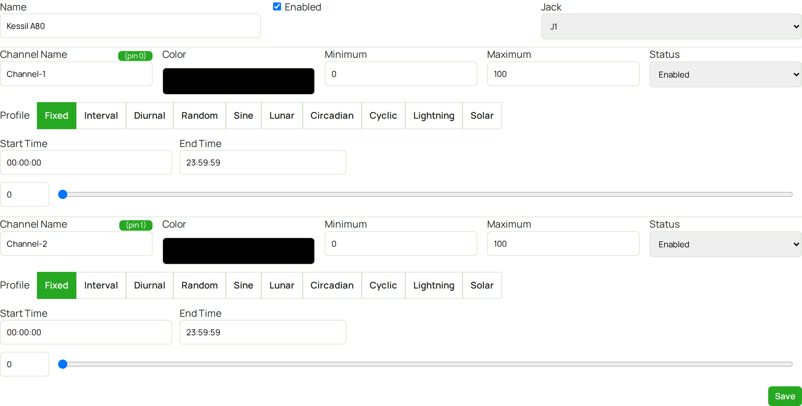
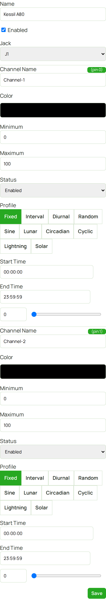

The diurnal profile allows users to simulate the daylight cycle by an exponential ramp up and ramp down
with most of the time operating at maximum PWM value. The diurnal profile cannot be visualized in the
reef-pi dashboard itself, but if you have adafruit.io integration enabled, then you can observe the
diurnal profile generated PWM values in your adafruit.io dashboard. Here is an example from my build:

The auto (interval) profile allows users to set a specific light intensity throughout the day at two
hour intervals. reef-pi linearly increments/decrements the PWM values in between the two-hour
intervals. This is an effective way to simulate the daylight cycle with finer control over how steep the
PWM value ramp up/down will be.

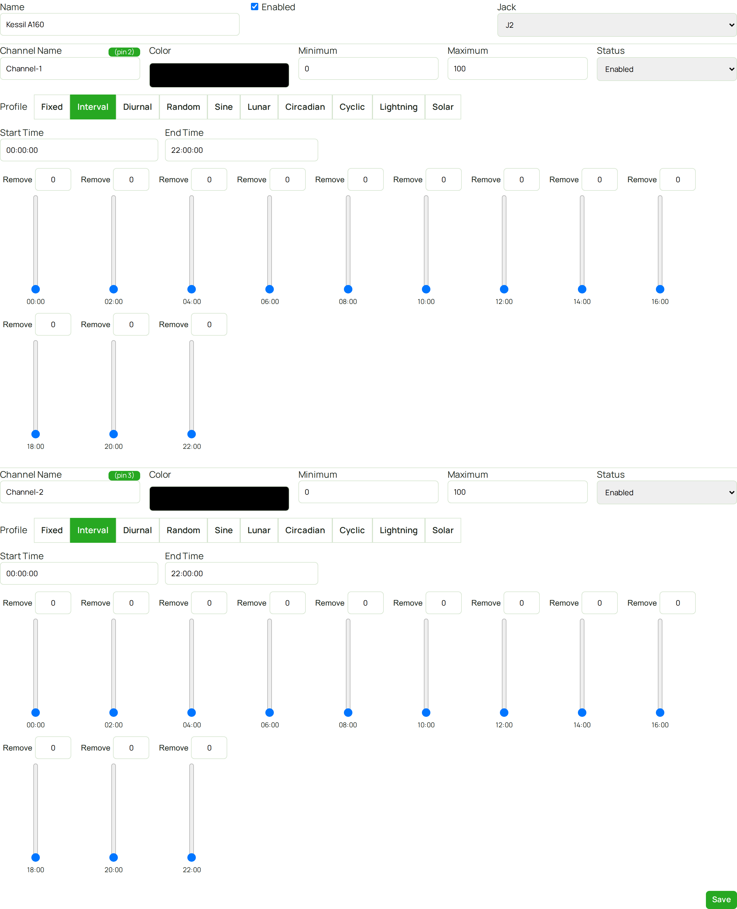
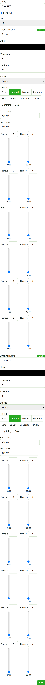

This build guide covers Kessil and actinic LED strip controllers, but the basic circuitry should work
for a variety of LED light types. reef-pi community members have used raw power MOSFETs to a Meanwell
LDD driver based control circuit for other proprietary/branded lights or cheaper (and often times not UL
listed) black boxes or completely DIY lights made with Cree or Luxeon LEDs (3W).

This guide uses an Adafruit PCA9685 board, which gives up to 16 PWM channels. If you need only two PWM
channels (e.g. only one Kessil light controller) then you can just use the Raspberry Pi. reef-pi can use
the Raspberry Pi's hardware timers (GPIO pin 18 & 19) natively for PWM. Just remember Pi based PWM pins
are limited to two and in the reef-pi UI they are denoted as pin 0 and 1 for GPIO pin 18 and 19.

Thank you for reading through the light controller guide, we'll look into the pH monitoring module in
reef-pi in our next guide.
