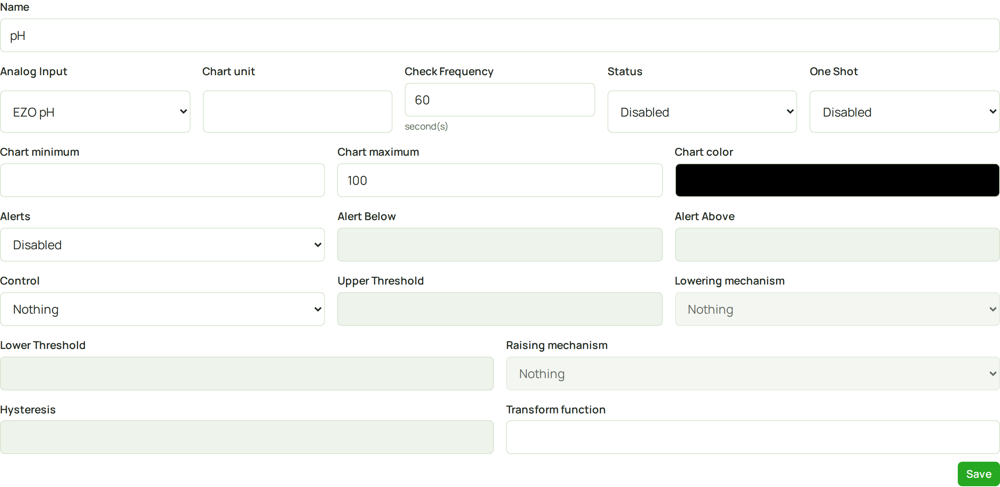
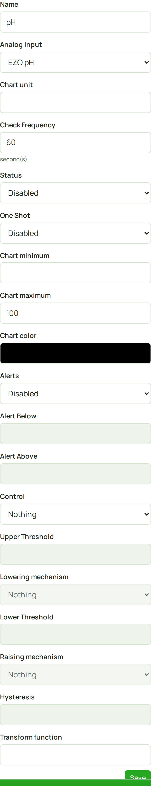
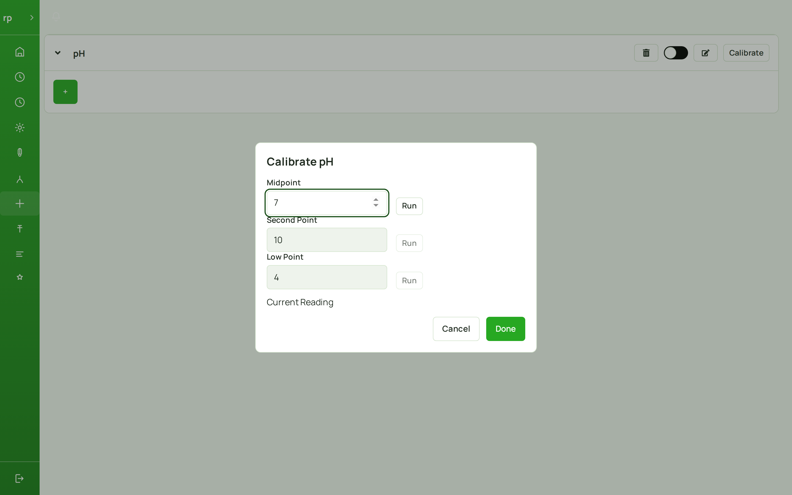
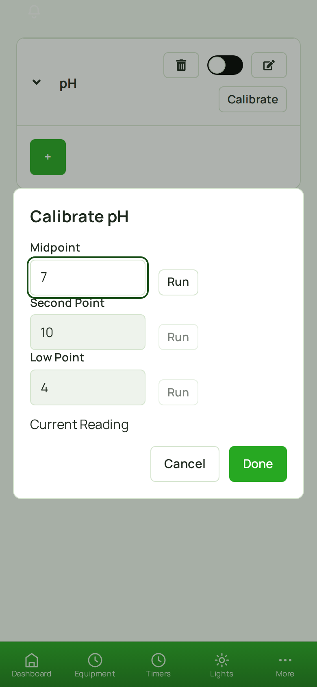

# reef-pi Guide 6: pH Monitoring

| | |
|---|---|
| Published guide | <https://learn.adafruit.com/reef-pi-guide-7-ph-monitoring> (the URL says "guide 7"; the page title is "Guide 6") |
| Author | Ranjib Dey |
| Guide number | 6 (of 7) |
| Screenshots reflect | reef-pi 7.0 (`main`); regenerate with `make guide-screenshots GUIDE=6` |
| Last synced with Adafruit | _not yet_ |

This is the working copy of the Adafruit Learn guide. Readers use the Adafruit page; edits are made
here and copied back by hand (see [the guides index](../README.md)). Hardware photos and diagrams are
linked from Adafruit's CDN (in page order; they are not changing); reef-pi screenshots are generated by
`front-end/e2e/guides/guide-06.spec.js`.

## Changes for 7.0

Copy-back checklist, per Adafruit page.

**Overview, Parts, Circuit Construction, Building The Housing:** no changes (hardware only).

**Configuration and Calibration** (three images)

- Image for "create a new probe by clicking the "+" sign": replace with
  `configuration-and-calibration-01-ph-new-probe-{desktop,mobile}.png`.
- Image for the calibration step: replace with
  `configuration-and-calibration-02-ph-calibration-{desktop,mobile}.png`.
- Image of the pH cycle in Adafruit IO: unchanged.
  **Check against the live page** which of the three images is which: the page source lists them in a
  different order than the timestamps in their file names suggest.
- Text "Navigate to the pH tab, and create a new probe by clicking the "+" sign. By default EZO circuit
  has I2C address of 0x99, unless you are changing it, keep it as it is. Add the probe in disable
  state." -> "Open the **pH** page and click **+**. Give the probe a name, pick its **Analog Input**
  (the EZO circuit, declared as a pH board driver with address 0x99 = 153, unless you changed it), set
  **Status** to **Disabled** and click **Save**." The 7.0 form also has Chart unit/minimum/maximum/color,
  One Shot, Alerts, Control and the lowering/raising mechanisms; the guide leaves them at their defaults.
- Text "Before using pH probe, we have to calibrate it. Depending upon what calibration solutions you are
  using choose the appropriate value and hit "Run"." -> "Click **Calibrate** on the probe's row" (the
  button is only enabled while the probe is disabled), then choose the value for each calibration
  solution (**Midpoint**, **Second Point**, **Low Point**) and click **Run**; click **Done** when
  finished. The three points are used in that order.
- Text "Once calibrated, enable the probe" -> use the on/off switch on the probe's row.
- Text "The readings can be viewed in the reef-pi dashboard directly" -> unchanged: the dashboard has a
  pH tile once a probe exists.

**Needs maintainer check**

- Mobile image 02: the dialog's Midpoint field is focused (dark outline) and the labels of the three
  fields sit close together ("Second Point" touches the Midpoint field): that is the 7.0 layout.
- The calibration dialog's **Current Reading** is blank in the screenshots (no pH hardware on the dev
  server). The old screenshot may have shown a live value.
- The old image showed a probe name and values specific to the author's tank; the new form uses the
  name `pH` and a 60 second check frequency.

## Overview

Welcome to the sixth guide in the reef-pi aquarium monitoring project series. In this part, we'll learn
how to use reef-pi to monitor aquarium pH.

Corals are sensitive to pH, and most tropical corals thrive in a pH range of 7.6 to 8.4. Due to the high
CO2 in the indoor air and various other biological factors in the aquariums, maintaining stable pH is
one of the main concerns in reef keeping. Stony corals require calcium and alkalinity additives for
their skeletal growth. But it is relatively hard to increase alkalinity without decreasing pH. Hence pH
is monitored closely and used as an indicator to decide how much calcium and alkalinity supplement is
safe.

For example, Acropora (a type of stony coral) is one of the most popular corals in the reef keeping
community. They are relatively harder to keep due to their strict requirements (precise water
chemistry, strong flow, strong light), but once provided with the appropriate environment can grow
rapidly and show a myriad of color morphs. pH monitoring and automated dosing (covered in the next
guide) are two useful pieces of equipment in the husbandry of hard to keep corals such as Acropora.

We are building a simple standalone pH monitor, with only a Pi Zero and a pH probe circuit from Atlas
Scientific. A small clear case housing is used to mount all the electronics. This build will monitor a
reef aquarium's water pH continuously. This will allow us to visualize the daily pH cycle and alert when
it goes out of range.

## Parts

I am listing all the electronics components required for the build, excluding the pH probe and
calibration solutions. pH probes can be found either on the [Atlas Scientific website](https://adafru.it/CY7)
or any of the popular marine aquarium vendor websites such as [Bulk Reef Supply](https://adafru.it/CY8)
or [Marine Depot](https://adafru.it/CY9). Most pH probes are interchangeable (as long as they use a BNC
connector), just make sure to get a saltwater friendly probe.

- 1 x [Raspberry Pi Zero](https://www.adafruit.com/product/3400)
- 1 x [Perma Proto board](https://www.adafruit.com/product/723): mint tin size
- 1 x [Male header pins](https://www.adafruit.com/product/3002)
- 1 x [Female headers](https://www.adafruit.com/product/598)
- 1 x [EZO pH circuit](https://www.amazon.com/dp/B00641R1PQ/): Atlas Scientific EZO pH circuit
- 1 x [BNC Connector and carrier board](https://www.atlas-scientific.com/product_pages/components/single_carrier_iso.html)
- 1 x [5V power adapter](https://www.adafruit.com/product/276)
- 1 x [Barrel jack](https://www.adafruit.com/product/610): panel mount
- 1 x [Enclosure](https://www.amazon.com/dp/B0725ZQGVP): plastic enclosure for the build
- 1 x [Female-Female jumper wire](https://www.adafruit.com/product/794)
- 1 x [Nylon standoffs](https://www.adafruit.com/product/3658)

## Circuit Construction

A pH monitoring circuit is one of the simplest circuits to construct in reef-pi. Here is a general
overview of the connections: the Raspberry Pi's I2C pins (SDA and SCL) are connected to the EZO circuit,
along with power (5V) and GND connections. You can find more details in the official
[Atlas Scientific wiring guide](https://adafru.it/MMa).

It is recommended to use two 4.7K pull up resistors for the SDA and SCL connections. We'll use a mint
tin size Perma Proto board to create 5V and GND rails and to mount male/female headers where the Pi, EZO
and input power will be connected. Here is a Fritzing breadboard view of the entire setup:

I am using yellow solid core wire to denote the SDA pin and green solid core wire to denote the SCL pin.
Female header pins are soldered to mount the EZO board and BNC connector.

Ignore the red solid core wire at the bottom, it was soldered by mistake. Also, there are four female
headers at the bottom to connect the BNC connector, but only the three rightmost ones are used.

EZO board attached to the female headers, and the entire circuit, including the BNC connector. Note: I
am using just a BNC connector here, but I recommend using the one with a carrier board for voltage
isolation (linked in the parts list).

That's it, next we'll move on to fabricating the enclosure.

## Building the Housing

We are using a small clear top plastic enclosure to house the entire circuit including the Raspberry Pi.
Start with drilling holes for mounting the BNC connector and barrel jack (for the input power supply) on
the bottom side of the enclosure.

Mark and drill holes to mount the Perma Proto board and the Raspberry Pi Zero. The Raspberry Pi Zero will
be mounted on the top panel, while the Perma Proto board will be mounted in the center. Use nylon
standoffs to mount the Raspberry Pi and the Perma Proto boards.

Raspberry Pi mounted.

Next mount the Perma Proto board and BNC connector.

Next mount the barrel jack (make sure to tin it and solder female jumper wires).

After that, connect all the components with female-female jumper wire. There will be four wires for the
Pi Zero: 5V, GND, SDA and SCL.

The build is complete at this point, screw on the top panel and proceed to configuration and testing.

## Configuration and Calibration

Once the housing and circuit are completed, plug the pH probe into the BNC connector, power up reef-pi
and head over to the UI. If you are not familiar with the reef-pi installation and UI, refer to
[the first guide](https://learn.adafruit.com/reef-pi-installation-and-configuration) in this series for
details.

Open the **pH** page and create a new probe by clicking the **+** sign. Give it a name and pick its
**Analog Input** (the EZO circuit). By default the EZO circuit has an I2C address of 0x99; unless you
are changing it, keep it as it is. Add the probe in the **Disabled** state and click **Save**.

Before using the pH probe, we have to calibrate it. Click **Calibrate** on the probe, and depending on
what calibration solutions you are using, choose the appropriate value and hit **Run**. reef-pi allows
one, two or three point calibration. Calibration is not an absolute requirement, but a highly
recommended step before usage.

Once calibrated, enable the probe and reef-pi will start monitoring your tank pH. The readings can be
viewed in the reef-pi dashboard directly. If you have enabled
[adafruit.io](https://adafru.it/eZ8), reef-pi will send the same data there as well and you can create
a dashboard there. Here is an example of my reef aquarium's pH cycle.

Now our reef-pi pH monitor is calibrated and operational. In the next guide, we'll build a dosing
system, and use the pH monitor as our guiding force to deduce the appropriate dosing amount of different
chemical additives. Thank you and see you in the next part in this series.
