# reef-pi Guide 7: Dosing Controller

| | |
|---|---|
| Published guide | <https://learn.adafruit.com/reef-pi-guide-5-dosing-controller> (the URL says "guide 5"; the page title is "Guide 7") |
| Author | Ranjib Dey |
| Guide number | 7 (of 7) |
| Screenshots reflect | reef-pi 7.0 (`main`); regenerate with `make guide-screenshots GUIDE=7` |
| Last synced with Adafruit | _not yet_ |

This is the working copy of the Adafruit Learn guide. Readers use the Adafruit page; edits are made
here and copied back by hand (see [the guides index](../README.md)). Hardware photos and diagrams are
linked from Adafruit's CDN (in page order; they are not changing; the Parts page's product photos are not
mirrored here); reef-pi screenshots are generated by `front-end/e2e/guides/guide-07.spec.js`.

## Changes for 7.0

Copy-back checklist, per Adafruit page.

**Overview, Parts, Circuit Construction, Building The Housing:** no changes (hardware only).

**Configuration & Testing** (the page has eight images; match them by position)

- Image 1 (Settings with the Dosers capability): replace with
  `configuration-testing-01-settings-capabilities-{desktop,mobile}.png`.
- Image 2 (the connectors): replace with `configuration-testing-02-connectors-{desktop,mobile}.png`.
- Image 3 (new dosing pump): replace with `configuration-testing-03-doser-new-pump-{desktop,mobile}.png`.
- Image 4 (list of pumps): replace with `configuration-testing-04-doser-pumps-{desktop,mobile}.png`.
- Image 5 (the four equipment items): replace with
  `configuration-testing-05-equipment-directions-{desktop,mobile}.png`.
- Image 6 (calibration): replace with `configuration-testing-06-doser-calibration-{desktop,mobile}.png`.
- Image 7 (measuring the dispensed liquid, a photo): unchanged.
- Image 8 (schedule): replace with `configuration-testing-07-doser-schedule-{desktop,mobile}.png`.
- Text "verify you have the doser capability enabled in settings section under configuration tab ... I am
  disabling the unrelated modules" -> "Configuration > Settings > Capabilities: tick **Dosers** (and
  **Equipment** for the direction trick), untick the modules you do not use, click **Update**".
- Text "reload reef-pi from the admin section under configuration" -> "Configuration > Admin > Reload".
- Text "declare two jacks, with rpi as the driver" and "create all the necessary connectors, four outlets
  and two jacks" -> "Configuration > Connectors > **Add connector**: choose the type **Outlet** or
  **Jack**, the **Raspberry Pi** driver, a name and the pin". The PWM jacks are pins `0` and `1` (GPIO 18
  and 19); in 7.0 each jack is listed as one pin. The outlets use GPIO 5 and 22 (pump 1) and 6 and 27
  (pump 2); **the second pump's pins are not given in the guide text, check them**.
- Text "Create two dosing pumps, associate each of them with one of the jack and its pin. Keep the pumps
  in the disabled state." -> Dosers page, **+**, name, type **DC motor**, **Jack**, **Pin**, **Status =
  Disabled**, plus the **Duration** and **Speed** the pump will dose with (both must be at least 1), then
  **Save**. The 7.0 form also offers a **Stepper** type, **Volume**, **Continuous** and **Soft Start**.
- Text "switch to the equipment tab and create four virtual equipment items" -> Equipment page, **+**,
  name and outlet.
- Text "click on the calibrate button. Set a PWM or speed value, which ranges from 1-100 and duration in
  seconds" -> unchanged; the dialog is titled "Calibrate <pump name>" and has **Speed** (%), **Duration**
  (s) and **Run**. Once reef-pi has started the pump, a second step asks for the measured volume (mL) and
  **Save calibration**, after which the dialog shows the pump's **Calibrated rate** in mL/s. Close it
  with **Done**.
- Text "Click on the edit button, set the schedule and enable the dosing pump" -> unchanged; set Hour `3`,
  Minute `0`, Second `0`, Duration `5`, Speed `50`, then switch the pump on with the toggle.

**Needs maintainer check**

- The example screenshots use pumps named Pump1/Pump2 on Jack1/Jack2; the old ones used the author's
  names.
- The calibration image shows the dialog before **Run** ("Not calibrated yet", no measured-volume step),
  because no pump was actually run. After a real run the dialog shows both.
- The old page predates stepper pumps (7.0 supports them, see
  [../../stepper-dosing-pumps.md](../../stepper-dosing-pumps.md)); the guide stays DC-motor only.

## Overview

Welcome to the seventh and final guide in the reef-pi series. In this guide, we'll learn how to use
reef-pi to build a dosing controller. This guide assumes you have familiarity with reef-pi, if not start
by reading [the first guide](https://learn.adafruit.com/reef-pi-installation-and-configuration) in this
series.

Dosing controllers, or dosers as they are popularly known, allow automated addition of liquid in reef
tanks. These liquids can be chemical reagents aimed at maintaining a certain type of chemistry (such as
optimum calcium or alkalinity levels) or microbial population (such as phytoplankton or nitrifying
bacteria) inside the reef tank.

Reef tank inhabitants such as corals, clams and other invertebrates consume certain minerals and release
biological waste, which changes the water chemistry over time. This rate of change continues to get
faster as the reef tank gets populated with more and more inhabitants.

A dosing system addresses these challenges by systematically replenishing needed elements. Oftentimes, a
dosing system is used with sensors (such as pH monitors) or manual water tests to deduce the optimum
rate of dosing. A popular dosing setup is to monitor pH and dose carbonate (to supplement calcium) and
bicarbonate (to supplement alkalinity) to support stony coral growth. This is called two-part dosing. In
this guide, we'll detail how to build such a dosing system, but the technique described here is generic
and can be extended for general purpose dosing of most liquids.

We'll be building a standalone unit for this. Since dosing systems are often located close to the
aquariums, building them as separate units helps us keep all other controllers (light, power etc)
completely isolated from it. This also allows isolation of failure domains, i.e. if the light controller
fails it will not impact the dosing system.

Below is a photograph of a fully assembled dosing system running on reef-pi.

The heart of the dosing system is the peristaltic pumps, which reef-pi uses to pour liquid at fixed
intervals at a fixed speed.

## Parts

Below is a listing of the parts required to build the dosing controller, including the housing and the
electronics. To calibrate the dosing controller, we'll use some measuring cylinders (or anything that
can be used to measure liquid volume at milliliter precision), which is not listed in the parts here.

- 1 x [Raspberry Pi Zero](https://www.adafruit.com/product/3708): Raspberry Pi Zero with headers
- 1 x [L293D](https://www.adafruit.com/product/807): motor driver IC
- 2 x [Peristaltic Pump](https://www.adafruit.com/product/1150): dosing pump
- 1 x [12V power adapter](https://www.adafruit.com/product/798)
- 1 x [Perma Proto HAT](https://www.adafruit.com/product/2310)
- 1 x [Solid core wire](https://www.adafruit.com/product/1311): solid core wire for jumpers
- 1 x [IC Socket](https://www.adafruit.com/product/2203): socket for mounting the L293D
- 1 x [Male headers](https://www.adafruit.com/product/3009): to connect the barrel jack and pumps
- 1 x [Panel mount barrel jack](https://www.adafruit.com/product/610): 2.1 mm panel mount female barrel jack
- 1 x [Male female jumper wire](https://www.adafruit.com/product/826)
- 1 x [Nylon Standoff](https://www.adafruit.com/product/3658)
- 1 x [Project box](https://www.amazon.com/dp/B0723DW8JM/): enclosure for the project
- 1 x [LM2596](https://www.amazon.com/dp/B00VW8R0IE/): buck converter

## Circuit Construction

The peristaltic pumps we are using are based on DC motors, which we'll be controlling using L293D ICs.
This is a perfect match for us, as this IC supports controlling two DC motors, their speed and
direction. If you want to know more about these ICs check out the
[Adafruit guide](https://adafru.it/D3Y) on how to use them with Raspberry Pi. The Raspberry Pi comes with
two hardware timers (PWMs) that we'll be using as the PWM sources for the L293D IC (each for one pump).
These pumps work on 12V, so we'll power the entire build with a 12V 1A adapter and use an LM2596
breakout board to generate the 5V power required for the Pi. Since this is a standalone build with only
two dosing pump controls, we can safely run this build with a Pi Zero, but a Pi 3 (or 2) will work just
fine.

Here is the [Fritzing](https://adafru.it/rdB) breadboard diagram for the entire circuit. In short, we
are using two hardware timers (GPIO18 & GPIO19) from the Raspberry Pi as PWM sources and 4 GPIO pins to
control the direction of the individual pumps.

Strip and trim one end of two female jumper wires. Solder them to the barrel jack. We'll use this to
connect the power adapter with the rest of the circuit.

Solder male header pins on the LM2596 module. We'll connect this to the 12V rails on the Perma Proto
board using female-female jumper wires.

I am using an Adafruit Perma Proto HAT to mount an 18 pin IC socket header, where the L293D IC will be
inserted. All jumper wires are made using 22 AWG solid core wire. The blue wires represent GPIO
(polarity or direction control) outputs, while green wires represent PWM/hardware timer outputs from the
Pi and yellow wires represent the 12V PWM output from the L293D that finally powers the peristaltic
pumps.

That's all, insert the L293D IC and we are good to go for mounting the circuit inside the enclosure and
testing it out.

## Building the Housing

We'll be using an uxcell 7x4x2" plastic enclosure to mount the entire circuit.

Start with cutting two large holes for mounting the peristaltic pumps at the bottom panel. I use a
Dremel tool for this work. You can also use large drill bits and a file to smooth things out.

Drill a hole on the side panel for the barrel jack connector that will be used to plug in the power
adapter.

Next, place the circuit components (LM2596 board, Perma Proto HAT etc) and mark the holes required for
placing nylon standoffs. Drill the holes and screw in the standoffs. Once the standoffs are affixed,
mount the LM2596 module and the Raspberry Pi Zero.

Next, attach the Perma Proto HAT on top of the Pi Zero. Notice I am using a large Pi HAT with the Pi
Zero, since it gives more space to work with and it works just fine. Affix the barrel jack connector as
well.

Once all the electronic components are mounted, attach the peristaltic pumps last, and connect all the
wires. Notice we are using the Perma Proto HAT to create a small 12V rail (on the right side) from which
the LM2596 and the L293D (Vmotor) draw their power.

> Please be sure the 12 volts does not connect to anything requiring only 5 volts, it may burn out 5
> volt components.

That's it, once all the components are wired, attach the clear case top and our dosing controller is
ready for some testing and calibration.

## Configuration & Testing

With the circuit and housing completed, let's proceed with configuring and calibrating our new dosing
system. Power up reef-pi and head to the reef-pi web UI. First, verify you have the **Dosers**
capability enabled under **Configuration > Settings**. Since this is a doser only build, I am disabling
the unrelated modules, such as lighting, temperature etc. We'll be using the equipment page for a trick,
I'll discuss that shortly.

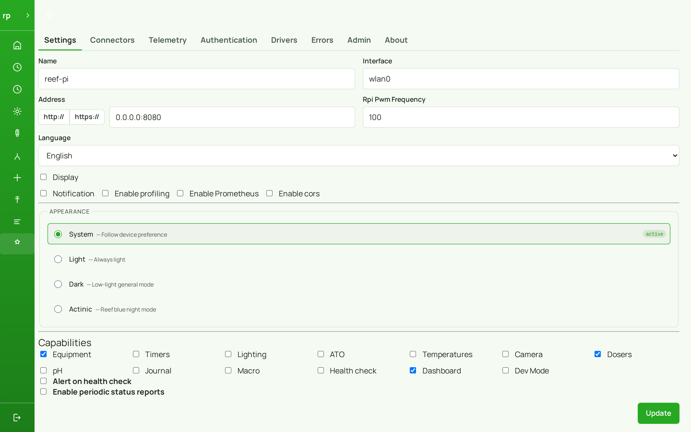
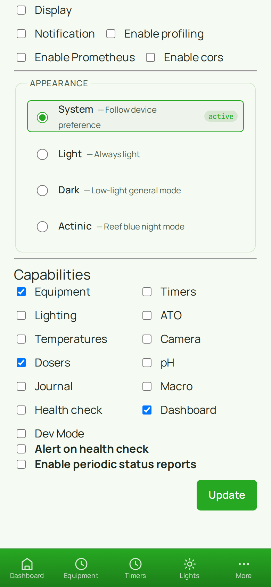

Once settings are updated, reload reef-pi from **Configuration > Admin**.

Lights, dosing pumps etc are all controlled by PWM pins which are represented as jacks in reef-pi. A jack
can have multiple pins. Every dosing pump is associated with one of the pins of a jack. Since we are
using the Raspberry Pi's hardware PWM (GPIO 18 and 19), we'll declare two jacks, with rpi as the driver
(it can be the PCA9685 IC as well).

We are using the L293D IC which allows us to control the direction of the peristaltic pump using two
input pins for each of the pumps. If both of these inputs are on or off, the pump is off. If one of them
is on and the other is off, then the pump runs. The pump's direction depends upon which of the input pins
is on. To simulate this, we'll employ a trick in reef-pi, where we'll create outlets with each of the
GPIOs (total 4) controlling the direction of the two peristaltic pumps. We'll create virtual equipment
with these GPIOs and then we can control the on/off state of the equipment, which in turn will control
the GPIO and thereby the direction of the pumps.

Now with this planned out, let's go ahead and create all the necessary connectors, four outlets and two
jacks, under **Configuration > Connectors**.

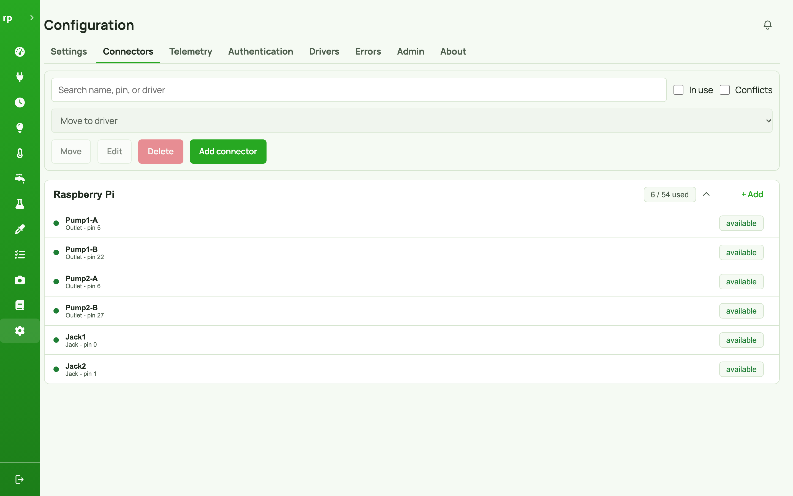
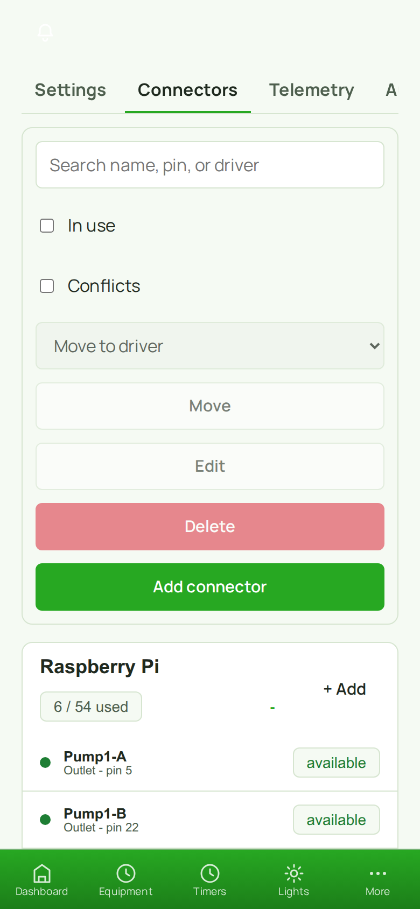

> Note, the PWM pins (jacks) are 0 and 1 which represent GPIO 18 and 19. This is because the Linux
> kernel maps them as 0 and 1.

Create two dosing pumps, associate each of them with one of the jacks and its pin. Keep the pumps in the
disabled state. We'll calibrate them before using them.

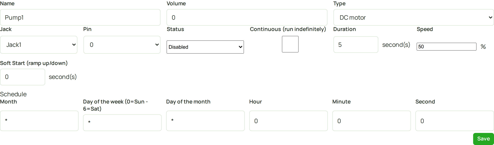
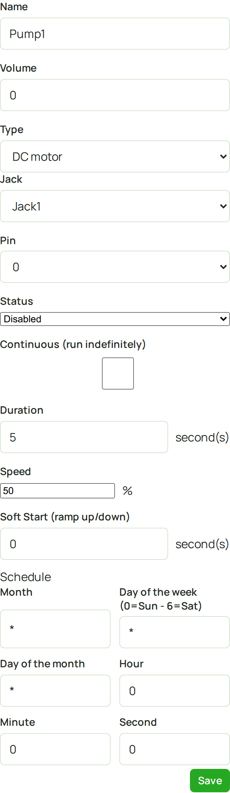

Here's the list of pumps in my dosing pumps page.

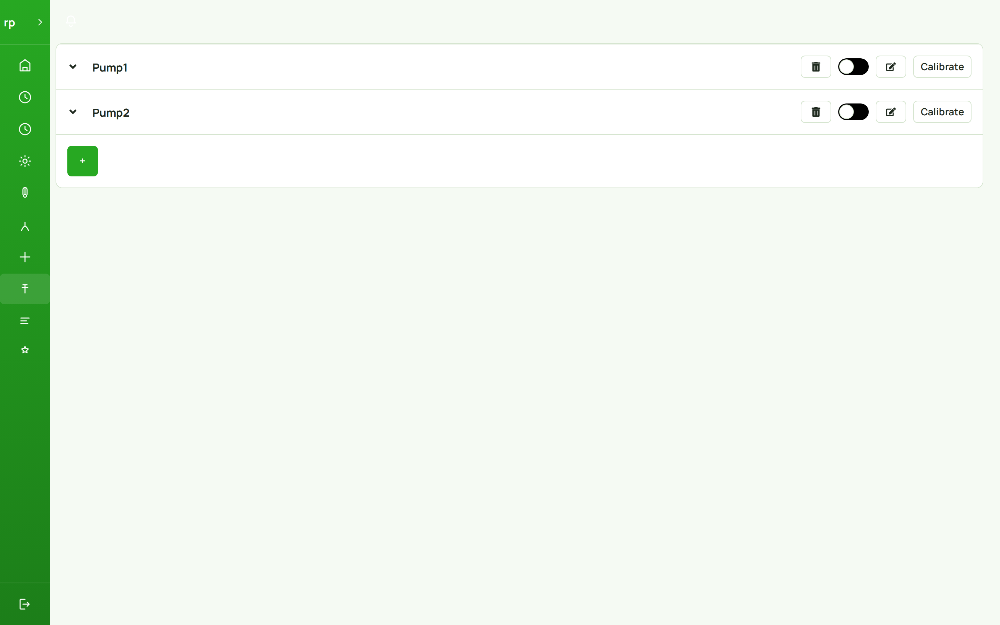
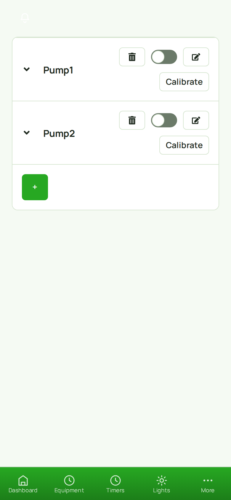

Next, switch to the equipment page and create four virtual equipment items and associate them with the
outlets. As per our circuit, GPIO 5 and 22 are controlling the first pump, hence when the equipment
associated with them (Pump1-A and Pump1-B) are both on or off, the pump will be off. The same goes for
the other pump. In the screenshot below, one of the equipment items associated with each pump is on,
while the other is off. Which means the pump will run (as long as there's a PWM output). If we make
Pump1-A off and Pump1-B on, that will change the direction of the first pump.

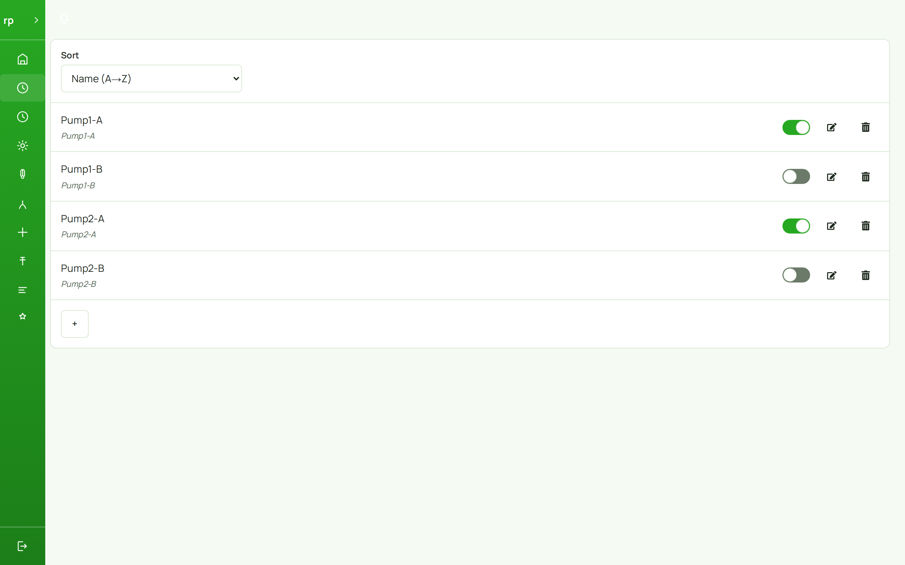
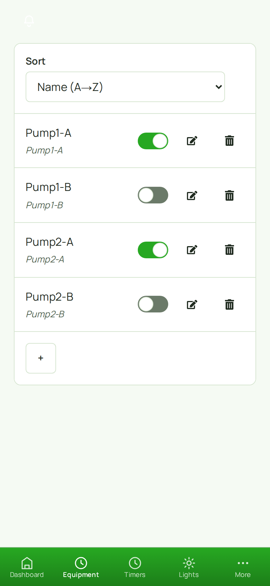

With the pump direction set, let's go back to the dosing pumps page and start calibrating the pump.
Different dosing pumps have different capacity (volume of liquid dispensed in unit time) and should be
calibrated before they are used. For calibration, individual dosing pumps in reef-pi must be in disabled
state. Click on the **Calibrate** button. Set a PWM or speed value, which ranges from 1-100 and duration
in seconds. Make sure you attach silicone tubing to your dosing pump and use some type of liquid (like
water) for testing. In this example I am using speed 70 and duration 15 seconds. This will instruct
reef-pi to run Pump1 for 15 seconds at 70% speed.

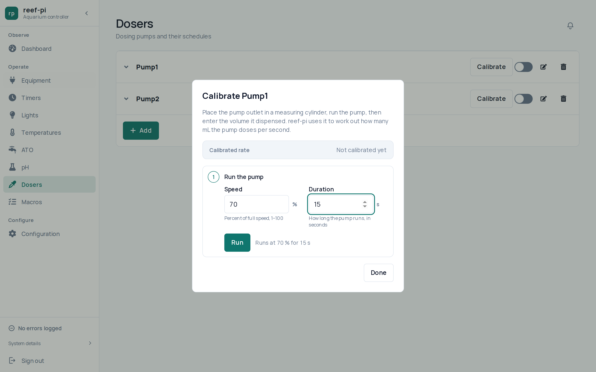
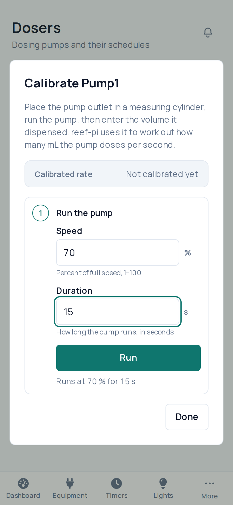

Use a measuring cylinder or similar vessel to measure the amount of liquid dispensed by the pump. For me
it was 5ml. Enter it as the **Measured volume** and click **Save calibration**: reef-pi works out the
pump's rate in mL per second and shows it as the **Calibrated rate**. This is the value that you'll use to
decide how long you need to run your dosing pump and at what speed, depending upon your dosing regimen.

I dose 2ml of two-part solution (calcium carbonate and alkalinity) every day. So, I went back and
scheduled my dosing pump to dose every night at 3 AM for 5 seconds at speed 50. Click on the edit button,
set the schedule and enable the dosing pump. That's all, your automatic dosing system is ready for
operation.

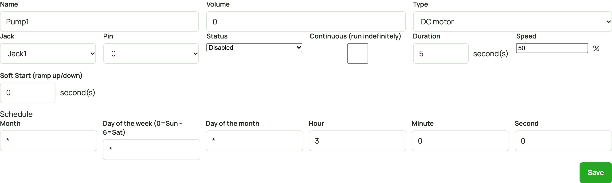
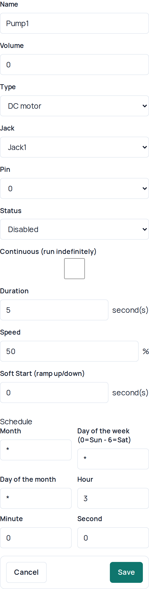

I highly recommend calibrating your dosing pumps every two months and using a dosing container with
volume indicators. This will make it easy to check how much liquid has been dispensed by the pumps over
a period of time. There are really expensive and precise dosing pumps on the market that will make this
much safer, but I rarely found they are necessary unless you are automating titration (we'll get back to
this later). For most reef keeping purposes, it's the amount of chemical over a time period that
matters, and we can always make a higher dilution and dispense them more frequently at a lower volume,
thus reducing our error margin. In most cases, you can use your pH sensor as a feedback mechanism to
check the effect of chemicals in the tank.

Thank you for reading through the 7th guide in the reef-pi series. I sincerely hope this series will
help you automate (or get started with) some of the chores involved in reef keeping, a hard but
rewarding hobby.
