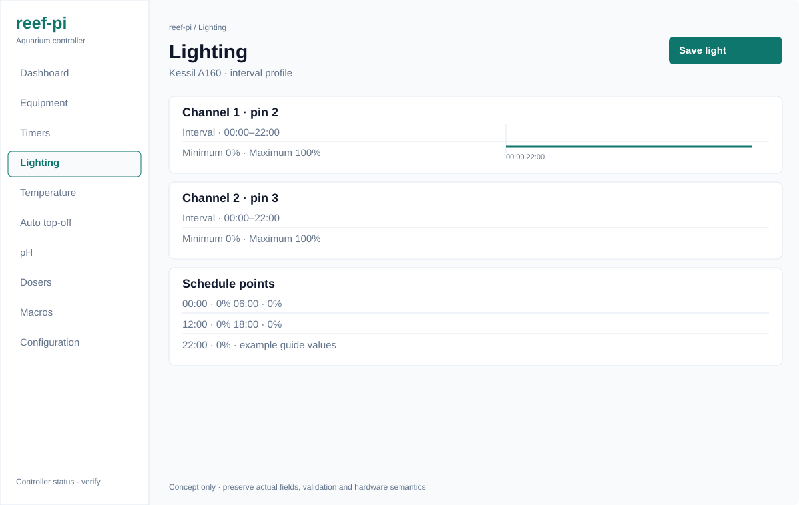
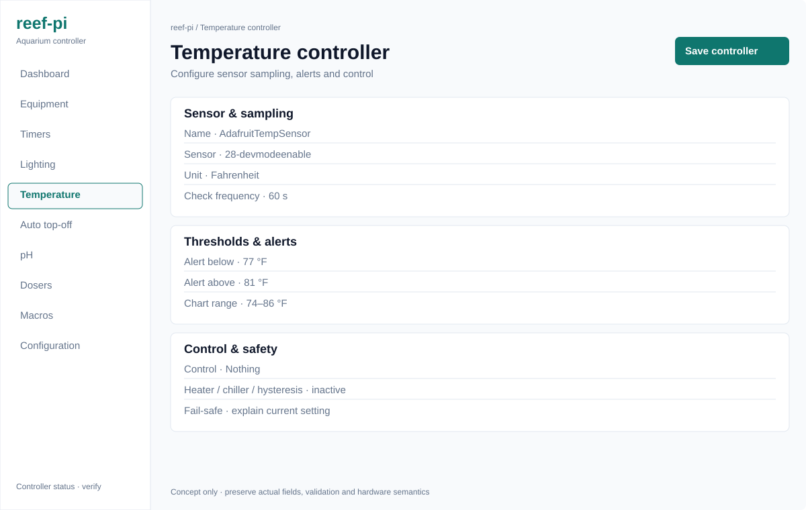

# Aquatic Precision — agent implementation contract

## Objective
Make reef-pi a premium, calm, precise, trustworthy local-first aquarium control platform. Use Linear/UniFi for visual restraint, Home Assistant for physical controls and Grafana for telemetry; no proprietary asset copying. This is an incremental UI modernization, not a rewrite.

## Evidence and scope
Guide READMEs at [baseline 5b02c1b](https://github.com/reef-pi/reef-pi/tree/5b02c1b6c8f2e5a8badb332fdd6fe4eec3ef227d/docs/guides) enumerate 45 distinct desktop screenshot references and companion mobile captures. A representative image from each of seven guides was visually reviewed, not every individual image. Also reviewed the earlier configuration screenshot and existing [design system](https://github.com/reef-pi/reef-pi/blob/main/front-end/design-system/README.md). Its documentation may lag actual code. Complete remaining per-image review as phase zero.

| Guide / visual evidence | Observed defect | Required target |
|---|---|---|
| [01 first-start dashboard](https://github.com/reef-pi/reef-pi/blob/main/docs/guides/01-setup-and-demonstration/images/installation-and-ui-overview-02-dashboard-first-start-desktop.png) | Uneven oversized empty tiles; equipment empty strip; dominant green rail | Compact setup checklist / contextual empty states; preserve configure links and capability gating; no fake telemetry |
| [02 equipment list](https://github.com/reef-pi/reef-pi/blob/main/docs/guides/02-power-controller/images/configure-and-test-04-equipment-list-desktop.png) | Huge whitespace between name and actions, anonymous switches and add button, unclear route heading | Named page header, Add equipment, dense aligned list, explicit command state, connector secondary label, overflow menu for edit/delete; review timers and macros for same patterns |
| [03 temperature form](https://github.com/reef-pi/reef-pi/blob/main/docs/guides/03-temperature-controller/images/configuration-testing-02-temperature-new-controller-desktop.png) | Flat full-width form, fail-safe buried beside one-shot, inconsistent units placement | Group sensor/sampling, visualization, thresholds/alerts, heater/chiller control and safety; explain disabled dependencies; explicit save; preserve every field |
| [04 ATO mobile expanded](https://github.com/reef-pi/reef-pi/blob/main/docs/guides/04-water-level-controller/images/configuration-testing-04-ato-expanded-mobile.png) | Reset/toggle/edit/delete wrap awkwardly; read-only data resembles disabled form; large vertical stack | Compact status header, labeled reset and overflow, read-only key/value summary, separate edit form, chart empty state, clear alert/disable-on-alert semantics |
| [05 lighting interval editor](https://github.com/reef-pi/reef-pi/blob/main/docs/guides/05-light-controller/images/configuration-testing-06-light-auto-profile-desktop.png) | Repeated vertical sliders and Remove labels, browser-blue thumbs, huge height, crowded profile tabs | Channel sections, 24-hour graph + accessible editable time/value table, profile selector, units and limits, compact fixed mode; preserve interpolation/profile behavior and all ten profile types |
| [06 pH calibration](https://github.com/reef-pi/reef-pi/blob/main/docs/guides/06-ph-monitoring/images/configuration-and-calibration-02-ph-calibration-desktop.png) | Unexplained disabled steps, blank current reading, inconsistent spacing | Guided calibration with existing midpoint/second/low point sequencing, explicit pending/result/error, units, cancel/done and supported skip semantics; no invented measurements |
| [07 doser calibration](https://github.com/reef-pi/reef-pi/blob/main/docs/guides/07-dosing-controller/images/configuration-testing-06-doser-calibration-desktop.png) | Speed/duration lack visible units, Run and close both primary, no context on pump activation | Disabled-state prerequisite, speed %, duration seconds, explicit run action, pending/result/error, measured volume mL and save result when supported; never run hardware in tests |

Also review login, admin, authentication, connectors, drivers, telemetry, timers, macros, configured dashboard, all module list/create/edit states and mobile screenshots. Camera, Journal, Health check and other enabled routes not covered by guides still require regression coverage.

## Design contract
- Neutral canvas and white panels, restrained aquatic teal, green reserved for healthy status. Light tokens: canvas #F8FAFC, panel #FFFFFF, border #E2E8F0, text #0F172A, muted #64748B, accent #0D9488, action #0F766E, success #16A34A, warning #D97706, critical #DC2626. Dark: #0D1117/#161B22/#30363D/#E6EDF3/#8B949E/#2DD4BF. Actinic: #060B1B/#0C1429/#1B2A4A/#C5D6F5/#8095BD/#648BFA. Validate contrast; optional Classic green theme; System follows OS.
- Extend existing semantic tokens and primitives; inspect actual stack before adding dependencies. Keep existing Manrope/JetBrains Mono if appropriate rather than unnecessary font churn; Inter/Geist Mono are alternatives only. Self-host; no CDN. Page 28px/600, section 18px/600, body 14px, labels 13px, telemetry 28–32px tabular. 4px grid, 8–16px component gaps, 24–32px section gaps, 36–40px desktop controls, 44px mobile targets, 6–8px controls/8–12px panels, subtle borders.
- Expanded labeled grouped navigation (Observe/Operate/Configure), collapsed accessible rail, preserve mobile bottom bar/More or equivalent discoverability. Standard page title, description, primary action. Move raw footer diagnostics into contextual system status; retain all links and fields. No unknown health labeled healthy.
- Configuration: group identity/network/PWM/language, capabilities by function, theme previews, advanced settings (display, notifications, profiling, Prometheus, CORS, Dev Mode), explicit dirty/save/reload feedback. Preserve Settings, Connectors, Telemetry, Authentication, Drivers, Errors, Admin, About.
- Dashboard: compact parameter cards, charts with units/thresholds/time range, stale/missing/loading/error states, equipment and next operation only if supported. Equipment: distinguish desired/commanded/observed state, automatic/manual mode, pending/failure/unknown, never infer physical activity from relay energization. No safety-critical behavior solely in UI.
- Shared Button/Input/Select/Switch/Checkbox/Dialog/Tabs/Status/EmptyState/PageHeader/Table/TelemetryCard components; sentence case, existing i18n, accessible labels, consistent icons, focus and validation. Avoid glassmorphism, decorative gradients, excessive animation.
- Proposed backend-dependent enhancements (timed override, dependency warnings, audit trail, observed hardware state) must be separately scoped/approved; do not invent API fields.

## Agent execution plan
- [ ] P0 inventory every checked-in guide screenshot and route; baseline commit, screenshot manifest, actual frontend architecture and performance; reconcile existing design-system and migration work (#2570).
- [ ] P0 consolidate semantic tokens, theme and primitive contracts; no parallel design system.
- [ ] P0 application shell, responsive nav, headers, status and login.
- [ ] P1 configuration, equipment, dashboard including fresh install.
- [ ] P1 temperature, ATO, lighting, pH and dosing forms/calibration; timers/macros; preserve behavior.
- [ ] P1 remaining routes and guide copy updates; regenerate screenshots using existing guide specs and documented make target (e.g. `make guide-screenshots GUIDE=1`).
- [ ] Ongoing verification: Playwright guide journeys, screenshot comparisons in all themes at desktop/tablet/mobile/narrow widths (1440/768/390/320), no unintended overflow; deterministic fixtures; axe plus manual WCAG 2.2 AA review; keyboard, focus, localization and reduced motion; mock command errors/stale sensors/reload/persistence, no live hardware commands; compare bundle/load/memory on representative Pi.
- [ ] Each PR includes before/after images, exact files, tests, deviations, risks and phase boundary. Human review before changing hardware semantics. Do not claim completion on untested gates.

## Reference assets
Original context pack contains README, tokens, and 12 PNG/SVG concepts for Configuration, Dashboard and Equipment in Light/Dark/Actinic/Classic. Original files are not yet uploaded to GitHub; this issue records the full core design contract and will link repository-native supplemental concepts if successfully published. Concepts are illustrative, not live readings or exhaustive controls.

## Claude Code / Codex entrypoint
Read this issue, linked guide images, existing design-system docs, and any linked reference assets. Audit the checkout first; produce exact-file phased PR plan; implement foundation and shell incrementally before module work. Preserve API, hardware behavior, local operation, and current guide workflows. Report verification evidence and deviations. Do not introduce libraries or backend changes without demonstrated need and approval.

## Supplemental concepts
These are newly authored repository-native SVG wireframes, not copies of the original downloadable pack. They are intentionally simplified and illustrative. Existing fields and behavior take precedence.

- [configuration-light.svg](screens/configuration-light.svg)
- [configuration-dark.svg](screens/configuration-dark.svg)
- [configuration-actinic.svg](screens/configuration-actinic.svg)
- [configuration-classic.svg](screens/configuration-classic.svg)
- [dashboard-light.svg](screens/dashboard-light.svg)
- [dashboard-dark.svg](screens/dashboard-dark.svg)
- [dashboard-actinic.svg](screens/dashboard-actinic.svg)
- [dashboard-classic.svg](screens/dashboard-classic.svg)
- [equipment-light.svg](screens/equipment-light.svg)
- [equipment-dark.svg](screens/equipment-dark.svg)
- [equipment-actinic.svg](screens/equipment-actinic.svg)
- [equipment-classic.svg](screens/equipment-classic.svg)
- [temperature-light.svg](screens/temperature-light.svg)
- [ato-light.svg](screens/ato-light.svg)
- [lighting-light.svg](screens/lighting-light.svg)
- [ph-light.svg](screens/ph-light.svg)
- [dosing-light.svg](screens/dosing-light.svg)

